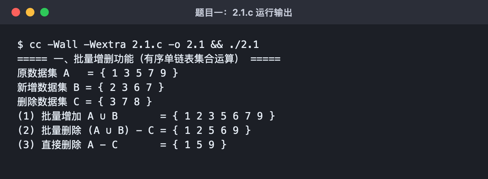
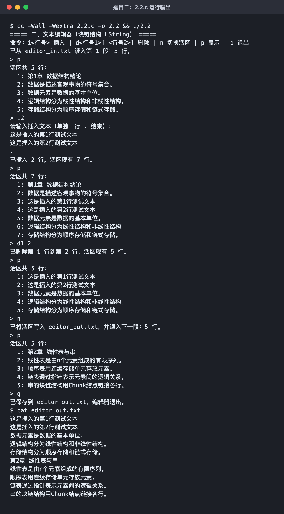
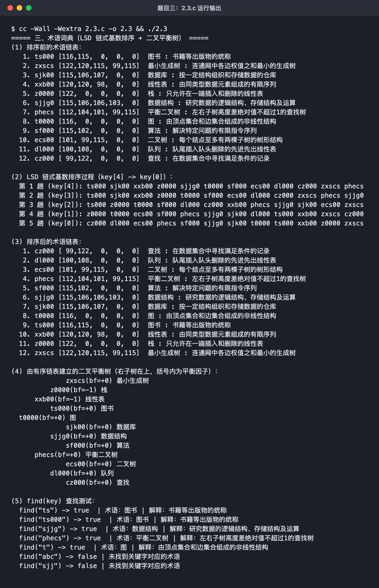
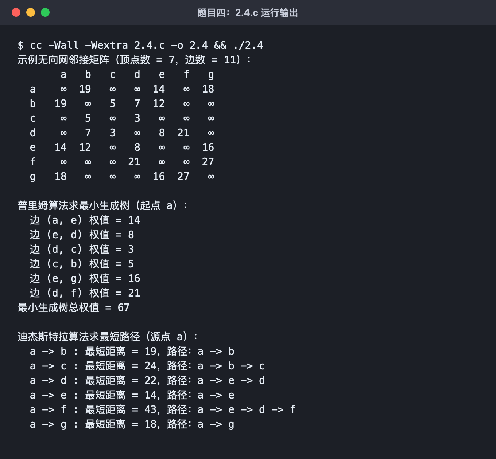
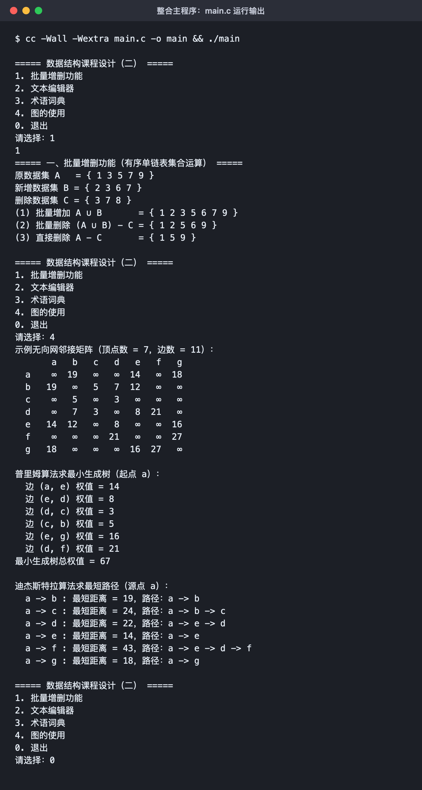

# 数据结构课程设计（二）实验报告

## 一、练习目的与要求

### 1. 练习目的
通过本次课程设计，将《数据结构》课程中所学的线性表（单链表）、串（块链串 `LString`）、排序（基于 LSD 的链式基数排序）、查找（二叉平衡树 AVL）以及图（最小生成树 Prim 算法、单源最短路径 Dijkstra 算法）等经典数据结构与算法进行综合编程应用，加深对数据结构逻辑表示、存储映象与算法实现之间关系的理解。

### 2. 练习要求
1. 将题目一至题目四在一个程序中整合实现，同时保持各题模块清晰、结构独立，编译运行成功并输出正确结果。
2. 代码中的结构体、函数、变量与常量命名严格与题设及课程课件（严蔚敏《数据结构》C 语言版）保持一致。
3. 实验报告包含题目要求、解决思路、完整代码与说明、运行结果及截图以及心得体会。

### 3. 文件组织与编译方式

源码位于 `code_final/` 目录下：

| 文件名 | 功能说明 |
| --- | --- |
| `main.c` | 整合主程序，通过 `#define NO_MAIN` 菜单式调度四道题 |
| `2.1.c` | 题目一：批量增删功能（带头结点有序单链表集合运算） |
| `2.2.c` | 题目二：文本编辑器（基于 `LString` 块链结构的活区行编辑） |
| `2.3.c` | 题目三：术语词典（LSD 链式基数排序 + 二叉平衡树 AVL + `find`） |
| `2.4.c` | 题目四：图的使用（邻接矩阵 `MGraph` + Prim 与 Dijkstra 算法） |
| `editor_in.txt` | 题目二文本编辑器的输入文本文件（共 10 行） |
| `editor_out.txt` | 题目二文本编辑器运行后生成的输出文件 |
| `screenshots/` | 各程序真实运行输出截图 |

编译命令（在 `code_final/` 目录下）：
```sh
cc -Wall -Wextra main.c -o main && ./main    # 运行整合菜单程序
# 亦可单独编译运行各题：
cc -Wall -Wextra 2.1.c -o 2.1 && ./2.1
cc -Wall -Wextra 2.2.c -o 2.2 && ./2.2
cc -Wall -Wextra 2.3.c -o 2.3 && ./2.3
cc -Wall -Wextra 2.4.c -o 2.4 && ./2.4
```

---

## 二、批量增删功能（`2.1.c`）

### 1. 题目要求
- 涉及集合运算，即原数据集 `A` 与新增数据集 `B`（批量增加），或删除数据集 `C`（批量删除）。
- 对任意一种**线性结构**存储的数据实现集合操作，至少包含以下基本操作：
  - 创建集合：`CreateSet(&T, Str)`
  - 求差集：`Difference(&T, S1, S2)`
  - 求并集：`Union(&T, S1, S2)`
  - 显示集合：`PrintSet(T)`

### 2. 解决思路
1. **数据结构设计**：采用**带头结点的递增有序单链表**（`LNode, *LinkList`，参考课件第 2 章线性表链表定义与有序表抽象数据类型）作为集合的存储结构。链表支持动态按需申请结点，且将元素保持递增有序后，去重、求并与求差都可以在单遍线性扫描中完成。
2. **`CreateSet(&T, Str)`**：先分配头结点并置 `(*T)->next = NULL`，再依次读取字符串 `Str` 中的字符调用辅助函数 `InsertElem` 按升序插入链表；若遇到链表中已存在的相同字符则跳过，直接保证集合的互异性。
3. **`Union(&T, S1, S2)`（批量增加）**：参考课件算法 2.1 与有序表二路归并思想，用双指针 `p`、`q` 同步扫描有序链表 `S1` 与 `S2`，每次选取较小字符尾插到结果集 `T`；若 `p->data == q->data` 则只插入一个并同时后移两指针，最后把剩余结点接入尾部，时间复杂度为 $O(|S_1| + |S_2|)$。
4. **`Difference(&T, S1, S2)`（批量删除）**：用双指针 `p`、`q` 同步扫描 `S1` 和 `S2`：当 `p->data < q->data` 时说明该元素仅在 `S1` 中，写入 `T`；当 `p->data == q->data` 时说明该元素在待删集 `S2` 中，跳过不写入；当 `q->data < p->data` 时仅后移 `q`。`S2` 扫描完后将 `S1` 剩余元素全部追加到 `T`。
5. **`PrintSet(T)`**：从 `T->next` 起依次遍历输出集合元素，验证 `A ∪ B`、`(A ∪ B) - C` 和 `A - C` 的结果。

### 3. 代码及说明（`2.1.c`）

```c
/* 课程设计 2.1  批量增删功能（有序单链表集合运算）
 * 数据结构：带头结点的递增有序单链表 LNode, *LinkList
 * 基本操作：CreateSet(&T, Str)、Union(&T, S1, S2)、Difference(&T, S1, S2)、PrintSet(T)
 */
#include <stdio.h>
#include <stdlib.h>

typedef struct LNode {
    char data;
    struct LNode *next;
} LNode, *LinkList;

/* 在链尾追加值为 e 的新结点，返回新链尾指针 */
static LNode *AppendNode(LNode *tail, char e) {
    LNode *s = (LNode *)malloc(sizeof(LNode));
    s->data = e;
    s->next = NULL;
    tail->next = s;
    return s;
}

/* 向有序集合 T 中插入元素 e（保持递增有序，若已存在则去重） */
static void InsertElem(LinkList T, char e) {
    LNode *p = T;
    while (p->next && p->next->data < e) p = p->next;
    if (p->next && p->next->data == e) return;
    LNode *s = (LNode *)malloc(sizeof(LNode));
    s->data = e;
    s->next = p->next;
    p->next = s;
}

/* 释放集合 T 的所有结点（含头结点） */
static void DestroySet(LinkList *T) {
    LNode *p = *T;
    while (p) {
        LNode *q = p->next;
        free(p);
        p = q;
    }
    *T = NULL;
}

/* 创建集合：由字符串 Str 创建带头结点的递增有序单链表集合 T */
void CreateSet(LinkList *T, const char *Str) {
    *T = (LinkList)malloc(sizeof(LNode));
    (*T)->next = NULL;
    for (; *Str; ++Str) InsertElem(*T, *Str);
}

/* 求并集：有序链表二路归并求 T = S1 ∪ S2 */
void Union(LinkList *T, LinkList S1, LinkList S2) {
    CreateSet(T, "");
    LNode *tail = *T, *p = S1->next, *q = S2->next;
    while (p && q) {
        if (p->data < q->data) {
            tail = AppendNode(tail, p->data);
            p = p->next;
        } else if (q->data < p->data) {
            tail = AppendNode(tail, q->data);
            q = q->next;
        } else {
            tail = AppendNode(tail, p->data);
            p = p->next;
            q = q->next;
        }
    }
    while (p) { tail = AppendNode(tail, p->data); p = p->next; }
    while (q) { tail = AppendNode(tail, q->data); q = q->next; }
}

/* 求差集：有序链表求 T = S1 - S2 */
void Difference(LinkList *T, LinkList S1, LinkList S2) {
    CreateSet(T, "");
    LNode *tail = *T, *p = S1->next, *q = S2->next;
    while (p && q) {
        if (p->data < q->data) {
            tail = AppendNode(tail, p->data);
            p = p->next;
        } else if (q->data < p->data) {
            q = q->next;
        } else {
            p = p->next;
            q = q->next;
        }
    }
    while (p) { tail = AppendNode(tail, p->data); p = p->next; }
}

/* 显示集合 T 的元素 */
void PrintSet(LinkList T) {
    printf("{ ");
    for (LNode *p = T->next; p; p = p->next) printf("%c ", p->data);
    printf("}\n");
}

int run_2_1(void) {
    LinkList A, B, C, U, D;

    printf("===== 一、批量增删功能（有序单链表集合运算） =====\n");
    CreateSet(&A, "513973");    /* 含乱序与重复字符 '3'，验证排序与去重 */
    CreateSet(&B, "6273");
    CreateSet(&C, "738");
    printf("原数据集 A   = "); PrintSet(A);
    printf("新增数据集 B = "); PrintSet(B);
    printf("删除数据集 C = "); PrintSet(C);

    Union(&U, A, B);
    printf("(1) 批量增加 A ∪ B       = "); PrintSet(U);
    Difference(&D, U, C);
    printf("(2) 批量删除 (A ∪ B) - C = "); PrintSet(D);
    DestroySet(&D);
    Difference(&D, A, C);
    printf("(3) 直接删除 A - C       = "); PrintSet(D);

    DestroySet(&A);
    DestroySet(&B);
    DestroySet(&C);
    DestroySet(&U);
    DestroySet(&D);
    return 0;
}

#ifndef NO_MAIN
int main(void) { return run_2_1(); }
#endif
```

**代码说明**：
- `AppendNode` 始终维护尾指针 `tail`，保证 `Union` 和 `Difference` 构造结果集时每次插入均为 $O(1)$。
- `InsertElem` 使 `CreateSet` 在建表阶段自动完成排序和去重（如输入 `"513973"` 自动生成 `{ 1 3 5 7 9 }`）。
- `DestroySet` 在运算结束时统一释放链表内存，防止通过主菜单多次运行时的内存泄漏。

### 4. 运行输出结果与截图

```text
===== 一、批量增删功能（有序单链表集合运算） =====
原数据集 A   = { 1 3 5 7 9 }
新增数据集 B = { 2 3 6 7 }
删除数据集 C = { 3 7 8 }
(1) 批量增加 A ∪ B       = { 1 2 3 5 6 7 9 }
(2) 批量删除 (A ∪ B) - C = { 1 2 5 6 9 }
(3) 直接删除 A - C       = { 1 5 9 }
```



### 5. 心得体会
通过第一题的实现，我深刻体会到“数据结构的选择直接决定了算法的复杂度”。如果直接使用无序单链表做集合运算，求并集和差集都必须嵌套循环扫描查找，时间复杂度为 $O(|S_1| \times |S_2|)$；而改用递增有序单链表存储后，利用两路归并的思想只需双指针单向推进即可同时完成求并与求差，复杂度降为线性的 $O(|S_1| + |S_2|)$。同时，使用带头结点的单链表配合尾指针 `tail`，统一了空表和首元结点的插入逻辑，代码简洁清晰。

---

## 三、文本编辑器（`2.2.c`）

### 1. 题目要求
- 实现文本编辑功能，并将最终的文本保存到文件中；设文件每行不超过 200 字。
- 实现以下 4 条基本编辑命令：
  1. **行插入**：`i<行号><回车><文本>.<回车>`，将 `<文本>` 插入活区中第 `<行号>` 行之后。
  2. **行删除**：`d<行号 1>[<空格><行号 2>]<回车>`，删除活区中第 `<行号 1>` 行（到第 `<行号 2>` 行）。
  3. **活区切换**：`n<回车>`，将活区写入输出文件，并从输入文件中读入下一段，作为新的活区。
  4. **活区显示**：`p<回车>`。
- 存储结构按题设与课件第 4 章给出的 `LString` 块链结构：每个结点存放一行定长串，行和行之间用指针相连。

### 2. 解决思路
1. **块链存储结构（`Chunk` 与 `LString`）**：严格按题设定义 `#define CHUNKSIZE 80`、块结点 `Chunk`（含 `char ch[CHUNKSIZE]` 与 `struct Chunk *next`）和链串 `LString`（含 `head`、`tail`、`curlen`）。遵循题设说明“整个文本编辑区可以看成是一个串，每一行是一个子串，构成一个结点”，每个 `Chunk` 直接存储活区中的一行文本，`curlen` 记录当前活区的行数。
2. **文件分段与活区初始化**：程序启动时打开输入文件 `editor_in.txt` 和输出文件 `editor_out.txt`，调用 `LoadEditorPage` 每次从输入文件读取最多 `EDITOR_PAGESIZE`（设为 5）行文本构造 `Chunk` 结点追加到活区链表 `S` 中。
3. **4 条编辑命令的链表实现**：
   - `i<行号>`：定位到第 `pos` 个 `Chunk` 结点 `prev`（若 `pos == 0` 则 `prev = NULL` 插到表头），循环读取输入文本直到遇到单独一行 `.` 结束，每行生成一个新 `Chunk` 并动态链入链表，实时更新 `head`、`tail` 和 `curlen`。
   - `d<行号1>[ <行号2>]`：用 `sscanf` 解析 1 个或 2 个行号；定位到第 `a` 行的前驱结点 `prev`，依次摘除并 `free` 第 `a` 至第 `b` 行共 `b - a + 1` 个 `Chunk` 结点，重接 `prev->next` 并维护 `head`、`tail` 与 `curlen`。
   - `n`：调用 `SaveLString` 遍历链表把当前活区内容逐行写入 `editor_out.txt`，清空释放当前活区后调用 `LoadEditorPage` 读入下一段。
   - `p`：从 `S->head` 遍历链表，按 `行号: 文本` 格式打印当前活区所有行。
   - 输入 `q`（或遇文件结束符 EOF）时，将当前活区和 `editor_in.txt` 中尚未读入的剩余行全部写入 `editor_out.txt` 后安全关闭文件并退出。

### 3. 代码及说明（`2.2.c`）

```c
/* 课程设计 2.2  文本编辑器（块链结构 LString）
 * 每行文本作为一个 Chunk 结点，行间通过指针连接。
 * 支持命令：
 *   i<行号>           行插入：随后输入多行文本，单独一行 . 结束（0 插到最前）
 *   d<行号1>[ <行号2>] 行删除：删除第 行号1 行（到第 行号2 行）
 *   n                 活区切换：写入 editor_out.txt 并从 editor_in.txt 读入下一段
 *   p                 活区显示：遍历链表打印当前活区各行及行号
 *   q                 保存当前活区及输入文件剩余行到 editor_out.txt 并退出
 */
#include <stdio.h>
#include <stdlib.h>
#include <string.h>

#define CHUNKSIZE 80 // 可由用户定义的块大小
typedef struct Chunk { // 结点结构
    char ch[CHUNKSIZE];
    struct Chunk *next;
} Chunk;

typedef struct { // 串的链表结构
    Chunk *head, *tail; // 串的头和尾指针
    int curlen;         // 串的当前长度
} LString;

static const int EDITOR_PAGESIZE = 5; // 每次从输入文件读入的最大行数

static void InitLString(LString *S) {
    S->head = S->tail = NULL;
    S->curlen = 0;
}

static void ClearLString(LString *S) {
    Chunk *p = S->head;
    while (p) {
        Chunk *q = p->next;
        free(p);
        p = q;
    }
    S->head = S->tail = NULL;
    S->curlen = 0;
}

static Chunk *CreateChunk(const char *line) {
    Chunk *node = (Chunk *)malloc(sizeof(Chunk));
    if (!node) return NULL;
    strncpy(node->ch, line, CHUNKSIZE - 1);
    node->ch[CHUNKSIZE - 1] = '\0';
    node->next = NULL;
    return node;
}

static void AppendChunk(LString *S, const char *line) {
    Chunk *node = CreateChunk(line);
    if (!node) return;
    if (S->tail) {
        S->tail->next = node;
    } else {
        S->head = node;
    }
    S->tail = node;
    S->curlen++;
}

static int ReadEditorLine(FILE *fp, char *buf, int size) {
    if (!fp || !fgets(buf, size, fp)) return 0;
    if (!strchr(buf, '\n')) {
        int ch;
        while ((ch = fgetc(fp)) != EOF && ch != '\n') {}
    }
    buf[strcspn(buf, "\r\n")] = '\0';
    return 1;
}

/* 从输入文件读入下一段（最多 EDITOR_PAGESIZE 行）作为新活区 */
static int LoadEditorPage(FILE *in, LString *S) {
    char buf[1024];
    ClearLString(S);
    while (in && S->curlen < EDITOR_PAGESIZE && ReadEditorLine(in, buf, sizeof(buf))) {
        AppendChunk(S, buf);
    }
    return S->curlen;
}

/* 将活区各结点写入输出文件 */
static void SaveLString(FILE *out, const LString *S) {
    if (!out) return;
    for (Chunk *p = S->head; p; p = p->next) {
        fprintf(out, "%s\n", p->ch);
    }
}

/* 遍历链表打印当前活区各行及行号 */
static void PrintLString(const LString *S) {
    printf("活区共 %d 行：\n", S->curlen);
    int line_no = 1;
    for (Chunk *p = S->head; p; p = p->next, ++line_no) {
        printf("%3d: %s\n", line_no, p->ch);
    }
}

/* 在第 pos 行之后插入多行文本（pos == 0 插在最前，单独一行 . 结束） */
static int InsertLinesAfter(LString *S, int pos) {
    Chunk *prev = NULL;
    if (pos > 0) {
        prev = S->head;
        for (int i = 1; i < pos; ++i) {
            prev = prev->next;
        }
    }

    char buf[1024];
    int added = 0;
    printf("请输入插入文本（单独一行 . 结束）：\n");
    while (ReadEditorLine(stdin, buf, sizeof(buf)) && strcmp(buf, ".") != 0) {
        Chunk *node = CreateChunk(buf);
        if (!node) break;
        if (prev == NULL) {
            node->next = S->head;
            S->head = node;
            if (S->tail == NULL) S->tail = node;
        } else {
            node->next = prev->next;
            prev->next = node;
            if (prev == S->tail) S->tail = node;
        }
        prev = node;
        S->curlen++;
        added++;
    }
    return added;
}

/* 删除第 a 行到第 b 行对应的结点并释放 */
static void DeleteLines(LString *S, int a, int b) {
    Chunk *prev = NULL;
    Chunk *cur = S->head;
    for (int i = 1; i < a; ++i) {
        prev = cur;
        cur = cur->next;
    }

    int count = b - a + 1;
    for (int i = 0; cur && i < count; ++i) {
        Chunk *next = cur->next;
        free(cur);
        cur = next;
        S->curlen--;
    }

    if (prev) {
        prev->next = cur;
    } else {
        S->head = cur;
    }
    if (!cur) {
        S->tail = prev;
    }
}

int run_2_2(void) {
    FILE *in = fopen("editor_in.txt", "r");
    FILE *out = fopen("editor_out.txt", "w");
    if (!out) {
        printf("无法创建输出文件 editor_out.txt。\n");
        if (in) fclose(in);
        return 1;
    }

    LString S;
    InitLString(&S);

    printf("===== 二、文本编辑器（块链结构 LString） =====\n");
    printf("命令：i<行号> 插入 | d<行号1>[ <行号2>] 删除 | n 切换活区 | p 显示 | q 退出\n");
    if (!in) {
        printf("提示：未找到 editor_in.txt，当前活区为空。\n");
    } else {
        int got = LoadEditorPage(in, &S);
        printf("已从 editor_in.txt 读入第 1 段：%d 行。\n", got);
    }

    char cmd[1024];
    while (printf("> "), fflush(stdout), ReadEditorLine(stdin, cmd, sizeof(cmd))) {
        char *p = cmd;
        while (*p == ' ' || *p == '\t') ++p;
        if (*p == '\0') continue;

        if (*p == 'i') {
            int k = 0;
            char extra;
            if (sscanf(p + 1, "%d %c", &k, &extra) != 1 || k < 0 || k > S.curlen) {
                printf("插入行号无效（有效范围 0~%d）。\n", S.curlen);
                continue;
            }
            int added = InsertLinesAfter(&S, k);
            printf("已插入 %d 行，活区现有 %d 行。\n", added, S.curlen);
        } else if (*p == 'd') {
            int a = 0, b = 0;
            char extra;
            int cnt = sscanf(p + 1, "%d %d %c", &a, &b, &extra);
            if (cnt != 1 && cnt != 2) {
                printf("删除命令格式错误，请使用 d<行号1>[ <行号2>]。\n");
                continue;
            }
            if (cnt == 1) b = a;
            if (S.curlen == 0 || a < 1 || b > S.curlen || a > b) {
                printf("删除行号无效（当前共 %d 行）。\n", S.curlen);
                continue;
            }
            DeleteLines(&S, a, b);
            printf("已删除第 %d 行到第 %d 行，活区现有 %d 行。\n", a, b, S.curlen);
        } else if (*p == 'n') {
            SaveLString(out, &S);
            int got = LoadEditorPage(in, &S);
            printf("已将活区写入 editor_out.txt，并读入下一段：%d 行。\n", got);
        } else if (*p == 'p') {
            PrintLString(&S);
        } else if (*p == 'q') {
            break;
        } else {
            printf("未知命令，请使用 i/d/n/p/q。\n");
        }
    }

    SaveLString(out, &S);
    while (in && ReadEditorLine(in, cmd, sizeof(cmd))) {
        fprintf(out, "%s\n", cmd);
    }
    ClearLString(&S);
    if (in) fclose(in);
    fclose(out);
    printf("已保存到 editor_out.txt，编辑器退出。\n");
    return 0;
}

#ifndef NO_MAIN
int main(void) { return run_2_2(); }
#endif
```

**代码说明**：
- 所有插入与删除都在块链结构 `LString` 上通过直接调整指针 `prev->next`、`S->head` 和 `S->tail` 完成，无需像顺序数组那样移动整段行数据。
- `InsertLinesAfter` 对“第 0 行后插入（即插在第一行之前）”和“在尾行之后追加”均做了正确处理，使 `tail` 始终指向最后一个结点。

### 4. 运行输出结果与截图

输入文件 `editor_in.txt` 共 10 行，运行中依次执行 `p`（显示第 1 段）、`i2`（在第 2 行后插入 2 行）、`p`、`d1 2`（删除第 1~2 行）、`p`、`n`（写入并切换到第 2 段）、`p`、`q`（保存退出）：

```text
===== 二、文本编辑器（块链结构 LString） =====
命令：i<行号> 插入 | d<行号1>[ <行号2>] 删除 | n 切换活区 | p 显示 | q 退出
已从 editor_in.txt 读入第 1 段：5 行。
> p
活区共 5 行：
  1: 第1章 数据结构绪论
  2: 数据是描述客观事物的符号集合。
  3: 数据元素是数据的基本单位。
  4: 逻辑结构分为线性结构和非线性结构。
  5: 存储结构分为顺序存储和链式存储。
> i2
请输入插入文本（单独一行 . 结束）：
这是插入的第1行测试文本
这是插入的第2行测试文本
.
已插入 2 行，活区现有 7 行。
> p
活区共 7 行：
  1: 第1章 数据结构绪论
  2: 数据是描述客观事物的符号集合。
  3: 这是插入的第1行测试文本
  4: 这是插入的第2行测试文本
  5: 数据元素是数据的基本单位。
  6: 逻辑结构分为线性结构和非线性结构。
  7: 存储结构分为顺序存储和链式存储。
> d1 2
已删除第 1 行到第 2 行，活区现有 5 行。
> p
活区共 5 行：
  1: 这是插入的第1行测试文本
  2: 这是插入的第2行测试文本
  3: 数据元素是数据的基本单位。
  4: 逻辑结构分为线性结构和非线性结构。
  5: 存储结构分为顺序存储和链式存储。
> n
已将活区写入 editor_out.txt，并读入下一段：5 行。
> p
活区共 5 行：
  1: 第2章 线性表与串
  2: 线性表是由n个元素组成的有限序列。
  3: 顺序表用连续存储单元存放元素。
  4: 链表通过指针表示元素间的逻辑关系。
  5: 串的块链结构用Chunk结点链接各行。
> q
已保存到 editor_out.txt，编辑器退出。
```

最终生成的 `editor_out.txt` 内容：
```text
这是插入的第1行测试文本
这是插入的第2行测试文本
数据元素是数据的基本单位。
逻辑结构分为线性结构和非线性结构。
存储结构分为顺序存储和链式存储。
第2章 线性表与串
线性表是由n个元素组成的有限序列。
顺序表用连续存储单元存放元素。
链表通过指针表示元素间的逻辑关系。
串的块链结构用Chunk结点链接各行。
```



### 5. 心得体会
通过第二题的开发，我对课件第 4 章中“块链串应用于文本编辑”的思路有了直观认识。传统顺序存储按行增删时常常伴随着整块数组元素的搬移，而以 `Chunk` 为行结点、`LString` 为活区链表后，无论是行插入还是区间行删除，都只需要修改前后指针即可在 $O(1)$ 局部操作内完成链接与释放。同时，在实现 `d` 删除和 `i` 插入时要格外注意边界条件——例如插入到 `pos == 0` 头部或 `tail` 尾部、删除包括首结点或尾结点在内的全部行时，必须同步更新 `S->head` 和 `S->tail`，否则在切换活区或继续插入时就会出现野指针或断链。

---

## 四、术语词典（`2.3.c`）

### 1. 题目要求
- 设一个术语不超过 5 个字，按前 5 个汉字的首个拼音字符（小写）的 ASCII 码作为 5 个关键字，不足 5 个的后几个补数字 `0`（例如“图书”对应 `'t'`、`'s'`、`'0'` 位置补 `0`，即 `[116, 115, 0, 0, 0]`）。
- 建立链表，每个结点包含：术语、5 个关键字、术语解释。
- 对该词典实现**基于 LSD 的链式基数排序**。
- 在此排序基础上，**建立一个二叉平衡树（AVL）**，并利用该结构实现查找功能 `find(key)`：找到则返回 `true` 并打印术语与解释，否则返回 `false`。

### 2. 解决思路
1. **术语链表与多关键字表示**：定义链表结点 `TermNode, *TermList`，包含 `term[20]`、`int key[5]`、`explain[100]` 和 `next`。内置 12 条常用数据结构术语（包含题设举例“图书”`ts`），通过 `MakeKeys` 将术语对应的拼音首字母串转为 5 个 `int` 型 ASCII 码，未满 5 位补整数 `0`。
2. **基于 LSD 的链式基数排序（`RadixSort`）**：设基数 `RADIX = 128`（覆盖 ASCII 范围 `0~127`），设置 128 个链队列头尾指针数组 `front[128]`、`rear[128]`。按最低位优先原则（LSD），从 `pass = 4` 倒序到 `pass = 0` 共进行 5 趟**分配**与**收集**：每趟先按 `p->key[pass]` 将结点链入对应桶的队列尾部，再按桶号 `0` 到 `127` 从小到大依次串联回单链表，并在每趟结束后输出序列以便观察排序过程。
3. **二叉平衡树构建（`BSTNode, *BSTree`）**：定义带平衡因子 `bf`（取值 `LH=1, EH=0, RH=-1`）的平衡二叉树结点 `BSTNode`。严格按照课件第 9 章逻辑实现右旋 `R_Rotate`、左旋 `L_Rotate`、左平衡调整 `LeftBalance`（LL 单右旋 / LR 先左后右双旋）、右平衡调整 `RightBalance`（RR 单左旋 / RL 先右后左双旋）及插入函数 `InsertAVL`。随后按基数排序后的有序链表顺序依次插入 AVL 树——虽然有序序列直接建普通 BST 会退化成单支斜树，但 AVL 树会在插入过程中自动通过平衡旋转保持整棵树平衡。
4. **`find(key)` 查找函数**：将传入的字符串参数 `key`（支持 `"ts"` 或 `"ts000"` 等格式）经 `MakeKeys` 转为 5 元数组后，从全局根指针 `g_avl` 出发执行二叉查找；匹配成功则打印术语与解释并返回 `true`，查找至空则返回 `false`。

### 3. 代码及说明（`2.3.c`）

```c
/* 课程设计 2.3  术语词典
 * 1. 链表结点 TermNode, *TermList 含术语、5 个 int 关键字、术语解释；
 * 2. 基于 LSD 的链式基数排序（从 key[4] 到 key[0] 共 5 趟分配与收集）；
 * 3. 由排好序的链表建立二叉平衡树（AVL），实现 find(key) 查找功能。
 */
#include <stdio.h>
#include <stdlib.h>
#include <string.h>
#include <stdbool.h>
#include <ctype.h>

#define KEY_NUM 5
#define RADIX   128
#define LH      1
#define EH      0
#define RH      -1

typedef struct TermNode {
    char term[20];
    int key[5];
    char explain[100];
    struct TermNode *next;
} TermNode, *TermList;

typedef struct BSTNode {
    char term[20];
    int key[5];
    char explain[100];
    int bf;
    struct BSTNode *lchild, *rchild;
} BSTNode, *BSTree;

static BSTree g_avl = NULL;

/* 将拼音首字母串（如 "ts" 或 "ts000"）转为 5 个小写 ASCII 码，'0' 或不足补 0 */
static void MakeKeys(const char *s, int key[KEY_NUM]) {
    int i = 0;
    for (; s[i] && i < KEY_NUM; ++i)
        key[i] = (s[i] == '0') ? 0 : tolower((unsigned char)s[i]);
    for (; i < KEY_NUM; ++i)
        key[i] = 0;
}

static int CmpKeys(const int a[KEY_NUM], const int b[KEY_NUM]) {
    for (int i = 0; i < KEY_NUM; ++i)
        if (a[i] != b[i]) return a[i] - b[i];
    return 0;
}

static void PrintKey(const int key[KEY_NUM]) {
    for (int i = 0; i < KEY_NUM; ++i)
        putchar(key[i] ? key[i] : '0');
}

/* ---------- 术语链表建立、打印与释放 ---------- */
static TermList CreateTermList(void) {
    static const char *DICT[][3] = {
        {"图书", "ts", "书籍等出版物的统称"},
        {"最小生成树", "zxscs", "连通网中各边权值之和最小的生成树"},
        {"数据库", "sjk", "按一定结构组织和存储数据的仓库"},
        {"线性表", "xxb", "由同类型数据元素组成的有限序列"},
        {"栈", "z", "只允许在一端插入和删除的线性表"},
        {"数据结构", "sjjg", "研究数据的逻辑结构、存储结构及运算"},
        {"平衡二叉树", "phecs", "左右子树高度差绝对值不超过1的查找树"},
        {"图", "t", "由顶点集合和边集合组成的非线性结构"},
        {"算法", "sf", "解决特定问题的有限指令序列"},
        {"二叉树", "ecs", "每个结点至多有两棵子树的树形结构"},
        {"队列", "dl", "队尾插入队头删除的先进先出线性表"},
        {"查找", "cz", "在数据集合中寻找满足条件的记录"}
    };
    TermList head = NULL, tail = NULL;
    int n = (int)(sizeof(DICT) / sizeof(DICT[0]));
    for (int i = 0; i < n; ++i) {
        TermNode *p = (TermNode *)malloc(sizeof(TermNode));
        strcpy(p->term, DICT[i][0]);
        MakeKeys(DICT[i][1], p->key);
        strcpy(p->explain, DICT[i][2]);
        p->next = NULL;
        if (tail) tail->next = p;
        else head = p;
        tail = p;
    }
    return head;
}

static void PrintTermList(TermList L) {
    int i = 0;
    for (; L; L = L->next) {
        printf("  %2d. ", ++i);
        PrintKey(L->key);
        printf(" [%3d,%3d,%3d,%3d,%3d]  %s : %s\n",
               L->key[0], L->key[1], L->key[2], L->key[3], L->key[4],
               L->term, L->explain);
    }
}

static void FreeTermList(TermList *L) {
    TermList p = *L;
    while (p) {
        TermList q = p->next;
        free(p);
        p = q;
    }
    *L = NULL;
}

/* ---------- 基于 LSD 的链式基数排序 ---------- */
static void RadixSort(TermList *L) {
    TermList front[RADIX], rear[RADIX];
    for (int pass = KEY_NUM - 1; pass >= 0; --pass) {
        for (int i = 0; i < RADIX; ++i)
            front[i] = rear[i] = NULL;
        for (TermList p = *L, next; p; p = next) {      /* 分配 */
            next = p->next;
            int d = p->key[pass];
            p->next = NULL;
            if (front[d]) rear[d]->next = p;
            else front[d] = p;
            rear[d] = p;
        }
        TermList tail = NULL;                           /* 收集 */
        *L = NULL;
        for (int i = 0; i < RADIX; ++i) {
            if (!front[i]) continue;
            if (tail) tail->next = front[i];
            else *L = front[i];
            tail = rear[i];
        }
        printf("  第 %d 趟 (key[%d]): ", KEY_NUM - pass, pass);
        for (TermList p = *L; p; p = p->next) {
            PrintKey(p->key);
            putchar(' ');
        }
        putchar('\n');
    }
}

/* ---------- 二叉平衡树（AVL） ---------- */
static void R_Rotate(BSTree *p) {                       /* 右旋 */
    BSTree lc = (*p)->lchild;
    (*p)->lchild = lc->rchild;
    lc->rchild = *p;
    *p = lc;
}

static void L_Rotate(BSTree *p) {                       /* 左旋 */
    BSTree rc = (*p)->rchild;
    (*p)->rchild = rc->lchild;
    rc->lchild = *p;
    *p = rc;
}

static void LeftBalance(BSTree *T) {                    /* 左平衡旋转处理 */
    BSTree lc = (*T)->lchild, rd;
    switch (lc->bf) {
    case LH:                                            /* LL 型：单右旋 */
        (*T)->bf = lc->bf = EH;
        R_Rotate(T);
        break;
    case RH:                                            /* LR 型：先左旋后右旋 */
        rd = lc->rchild;
        switch (rd->bf) {
        case LH: (*T)->bf = RH; lc->bf = EH; break;
        case EH: (*T)->bf = lc->bf = EH; break;
        case RH: (*T)->bf = EH; lc->bf = LH; break;
        }
        rd->bf = EH;
        L_Rotate(&(*T)->lchild);
        R_Rotate(T);
        break;
    }
}

static void RightBalance(BSTree *T) {                   /* 右平衡旋转处理 */
    BSTree rc = (*T)->rchild, ld;
    switch (rc->bf) {
    case RH:                                            /* RR 型：单左旋 */
        (*T)->bf = rc->bf = EH;
        L_Rotate(T);
        break;
    case LH:                                            /* RL 型：先右旋后左旋 */
        ld = rc->lchild;
        switch (ld->bf) {
        case LH: (*T)->bf = EH; rc->bf = RH; break;
        case EH: (*T)->bf = rc->bf = EH; break;
        case RH: (*T)->bf = LH; rc->bf = EH; break;
        }
        ld->bf = EH;
        R_Rotate(&(*T)->rchild);
        L_Rotate(T);
        break;
    }
}

static int InsertAVL(BSTree *T, const TermNode *e, bool *taller) {
    if (!*T) {
        *T = (BSTree)malloc(sizeof(BSTNode));
        strcpy((*T)->term, e->term);
        memcpy((*T)->key, e->key, sizeof((*T)->key));
        strcpy((*T)->explain, e->explain);
        (*T)->lchild = (*T)->rchild = NULL;
        (*T)->bf = EH;
        *taller = true;
        return 1;
    }
    int cmp = CmpKeys(e->key, (*T)->key);
    if (cmp == 0) {
        *taller = false;
        return 0;
    }
    if (cmp < 0) {
        if (!InsertAVL(&(*T)->lchild, e, taller)) return 0;
        if (*taller) {
            switch ((*T)->bf) {
            case LH: LeftBalance(T); *taller = false; break;
            case EH: (*T)->bf = LH; *taller = true; break;
            case RH: (*T)->bf = EH; *taller = false; break;
            }
        }
    } else {
        if (!InsertAVL(&(*T)->rchild, e, taller)) return 0;
        if (*taller) {
            switch ((*T)->bf) {
            case LH: (*T)->bf = EH; *taller = false; break;
            case EH: (*T)->bf = RH; *taller = true; break;
            case RH: RightBalance(T); *taller = false; break;
            }
        }
    }
    return 1;
}

static void PrintAVL(BSTree T, int depth) {             /* 横向打印 AVL 树（右子树在上） */
    if (!T) return;
    PrintAVL(T->rchild, depth + 1);
    printf("  %*s", depth * 4, "");
    PrintKey(T->key);
    printf("(bf=%+d) %s\n", T->bf, T->term);
    PrintAVL(T->lchild, depth + 1);
}

static void FreeAVL(BSTree *T) {
    if (!*T) return;
    FreeAVL(&(*T)->lchild);
    FreeAVL(&(*T)->rchild);
    free(*T);
    *T = NULL;
}

/* 在已建立的二叉平衡树中按关键字查找，找到打印术语与解释并返回 true，否则返回 false */
bool find(const char *key) {
    int k[KEY_NUM];
    MakeKeys(key, k);
    BSTree p = g_avl;
    while (p) {
        int cmp = CmpKeys(k, p->key);
        if (cmp == 0) {
            printf("  find(\"%s\") -> true  | 术语：%s | 解释：%s\n",
                   key, p->term, p->explain);
            return true;
        }
        p = (cmp < 0) ? p->lchild : p->rchild;
    }
    printf("  find(\"%s\") -> false | 未找到关键字对应的术语\n", key);
    return false;
}

int run_2_3(void) {
    printf("===== 三、术语词典（LSD 链式基数排序 + 二叉平衡树） =====\n");

    TermList list = CreateTermList();
    printf("(1) 排序前的术语链表：\n");
    PrintTermList(list);

    printf("\n(2) LSD 链式基数排序过程（key[4] -> key[0]）：\n");
    RadixSort(&list);

    printf("\n(3) 排序后的术语链表：\n");
    PrintTermList(list);

    FreeAVL(&g_avl);
    for (TermList p = list; p; p = p->next) {
        bool taller = false;
        InsertAVL(&g_avl, p, &taller);
    }
    printf("\n(4) 由有序链表建立的二叉平衡树（右子树在上，括号内为平衡因子）：\n");
    PrintAVL(g_avl, 0);

    printf("\n(5) find(key) 查找测试：\n");
    find("ts");
    find("ts000");
    find("sjjg");
    find("phecs");
    find("t");
    find("abc");
    find("sjj");

    FreeTermList(&list);
    FreeAVL(&g_avl);
    return 0;
}

#ifndef NO_MAIN
int main(void) { return run_2_3(); }
#endif
```

**代码说明**：
- `RadixSort` 直接修改单链表指针进行分配与收集，不额外移动结构体数据域，充分体现链式基数排序优势。
- 补位值数字 `0` 的数值小于小写字母 ASCII 码（`97~122`），因此在排序时 `"t0000"`（图）会自然排在 `"ts000"`（图书）之前，符合字典序规范。

### 4. 运行输出结果与截图

```text
===== 三、术语词典（LSD 链式基数排序 + 二叉平衡树） =====
(1) 排序前的术语链表：
   1. ts000 [116,115,  0,  0,  0]  图书 : 书籍等出版物的统称
   2. zxscs [122,120,115, 99,115]  最小生成树 : 连通网中各边权值之和最小的生成树
   3. sjk00 [115,106,107,  0,  0]  数据库 : 按一定结构组织和存储数据的仓库
   4. xxb00 [120,120, 98,  0,  0]  线性表 : 由同类型数据元素组成的有限序列
   5. z0000 [122,  0,  0,  0,  0]  栈 : 只允许在一端插入和删除的线性表
   6. sjjg0 [115,106,106,103,  0]  数据结构 : 研究数据的逻辑结构、存储结构及运算
   7. phecs [112,104,101, 99,115]  平衡二叉树 : 左右子树高度差绝对值不超过1的查找树
   8. t0000 [116,  0,  0,  0,  0]  图 : 由顶点集合和边集合组成的非线性结构
   9. sf000 [115,102,  0,  0,  0]  算法 : 解决特定问题的有限指令序列
  10. ecs00 [101, 99,115,  0,  0]  二叉树 : 每个结点至多有两棵子树的树形结构
  11. dl000 [100,108,  0,  0,  0]  队列 : 队尾插入队头删除的先进先出线性表
  12. cz000 [ 99,122,  0,  0,  0]  查找 : 在数据集合中寻找满足条件的记录

(2) LSD 链式基数排序过程（key[4] -> key[0]）：
  第 1 趟 (key[4]): ts000 sjk00 xxb00 z0000 sjjg0 t0000 sf000 ecs00 dl000 cz000 zxscs phecs 
  第 2 趟 (key[3]): ts000 sjk00 xxb00 z0000 t0000 sf000 ecs00 dl000 cz000 zxscs phecs sjjg0 
  第 3 趟 (key[2]): ts000 z0000 t0000 sf000 dl000 cz000 xxb00 phecs sjjg0 sjk00 ecs00 zxscs 
  第 4 趟 (key[1]): z0000 t0000 ecs00 sf000 phecs sjjg0 sjk00 dl000 ts000 xxb00 zxscs cz000 
  第 5 趟 (key[0]): cz000 dl000 ecs00 phecs sf000 sjjg0 sjk00 t0000 ts000 xxb00 z0000 zxscs 

(3) 排序后的术语链表：
   1. cz000 [ 99,122,  0,  0,  0]  查找 : 在数据集合中寻找满足条件的记录
   2. dl000 [100,108,  0,  0,  0]  队列 : 队尾插入队头删除的先进先出线性表
   3. ecs00 [101, 99,115,  0,  0]  二叉树 : 每个结点至多有两棵子树的树形结构
   4. phecs [112,104,101, 99,115]  平衡二叉树 : 左右子树高度差绝对值不超过1的查找树
   5. sf000 [115,102,  0,  0,  0]  算法 : 解决特定问题的有限指令序列
   6. sjjg0 [115,106,106,103,  0]  数据结构 : 研究数据的逻辑结构、存储结构及运算
   7. sjk00 [115,106,107,  0,  0]  数据库 : 按一定结构组织和存储数据的仓库
   8. t0000 [116,  0,  0,  0,  0]  图 : 由顶点集合和边集合组成的非线性结构
   9. ts000 [116,115,  0,  0,  0]  图书 : 书籍等出版物的统称
  10. xxb00 [120,120, 98,  0,  0]  线性表 : 由同类型数据元素组成的有限序列
  11. z0000 [122,  0,  0,  0,  0]  栈 : 只允许在一端插入和删除的线性表
  12. zxscs [122,120,115, 99,115]  最小生成树 : 连通网中各边权值之和最小的生成树

(4) 由有序链表建立的二叉平衡树（右子树在上，括号内为平衡因子）：
              zxscs(bf=+0) 最小生成树
          z0000(bf=-1) 栈
      xxb00(bf=-1) 线性表
          ts000(bf=+0) 图书
  t0000(bf=+0) 图
              sjk00(bf=+0) 数据库
          sjjg0(bf=+0) 数据结构
              sf000(bf=+0) 算法
      phecs(bf=+0) 平衡二叉树
              ecs00(bf=+0) 二叉树
          dl000(bf=+0) 队列
              cz000(bf=+0) 查找

(5) find(key) 查找测试：
  find("ts") -> true  | 术语：图书 | 解释：书籍等出版物的统称
  find("ts000") -> true  | 术语：图书 | 解释：书籍等出版物的统称
  find("sjjg") -> true  | 术语：数据结构 | 解释：研究数据的逻辑结构、存储结构及运算
  find("phecs") -> true  | 术语：平衡二叉树 | 解释：左右子树高度差绝对值不超过1的查找树
  find("t") -> true  | 术语：图 | 解释：由顶点集合和边集合组成的非线性结构
  find("abc") -> false | 未找到关键字对应的术语
  find("sjj") -> false | 未找到关键字对应的术语
```



### 5. 心得体会
本题把排序和查找两大经典章节串联在了一起。一方面，在基于 LSD 的链式基数排序中，“稳定性”是算法正确的前提——必须借助 `front`、`rear` 队列保证同一桶内元素保持先入先出的原有次序，才能使前一位的排序结果在后一趟中不被破坏；另一方面，将已经严格递增的有序链表逐个插入二叉树时，若使用普通二叉排序树必然退化为深度 12 的右斜单支树，查找退化为 $O(n)$；而借助 AVL 树在插入时持续触发左旋调整平衡，12 个结点仅形成了一棵深度为 4、所有结点平衡因子绝对值均不超过 1 的平衡二叉树，直观印证了课件中“平衡树查找长度维持在 $O(\log n)$ 量级”的结论。

---

## 五、图的使用（`2.4.c`）

### 1. 题目要求
- 选做模块：在本次课设中应用**普里姆（Prim）算法、克鲁斯卡尔（Kruskal）算法、迪杰斯特拉（Dijkstra）算法、弗洛伊德（Floyd）算法**中的一种或几种。
- 本程序结合课件第 7 章实现了**普里姆算法（`MiniSpanTree_P`）**与**迪杰斯特拉算法（`ShortestPath_DIJ`）**。

### 2. 解决思路
1. **图的邻接矩阵定义与构建**：参照课件第 7 章定义 `MGraph`（包含顶点向量 `vexs`、邻接矩阵 `arcs`、顶点数 `vexnum` 和边数 `arcnum`），以课件第 7 章 P61 的 7 顶点（`a~g`）、11 条边带权无向网为例通过 `CreateUDN` 构建对称邻接矩阵（不相邻位置设为 `GRAPH_INF = 99999`）。
2. **普里姆（Prim）算法 `MiniSpanTree_P`**：定义课件中的辅助数组 `closedge[MAX_VERTEX_NUM]`（含 `adjvex` 和 `lowcost`），记录未并入集合 $U$ 的各顶点到 $U$ 中顶点的最小代价边。初始将起点 `u` 并入 $U$（`lowcost = 0`），循环 `vexnum - 1` 次，每次通过 `minimum` 选出 `lowcost` 最小的顶点 `k` 输出生成树边并累加总权值，再以 `k` 为新桥梁更新其余顶点在 `closedge` 中的最小边。
3. **迪杰斯特拉（Dijkstra）算法 `ShortestPath_DIJ`**：维护 `final[]`（标记已确定最短路径的集合 $S$）、`Dist[]`（当前源点 `v0` 到各顶点的最短距离）与 `path[]`（前驱顶点下标）。初始由 `v0` 出发的直接边初始化 `Dist` 与 `path`；随后循环 `vexnum - 1` 轮，每轮选取 `V - S` 中 `Dist` 最小的顶点 `v` 并入 $S$，并按 `min + G.arcs[v][w] < Dist[w]` 松弛更新其余顶点；最后借助临时数组回溯 `path[]` 按正序打印出源点到各顶点的完整最短路径。

### 3. 代码及说明（`2.4.c`）

```c
#include <stdio.h>

#define MAX_VERTEX_NUM 20
#define GRAPH_INF 99999

typedef struct {
    char vexs[MAX_VERTEX_NUM];                  /* 顶点向量 */
    int arcs[MAX_VERTEX_NUM][MAX_VERTEX_NUM];   /* 邻接矩阵 */
    int vexnum, arcnum;                         /* 顶点数和边数 */
} MGraph;

static struct {
    int adjvex;                                 /* U 集中的顶点下标 */
    int lowcost;                                /* 边的权值 */
} closedge[MAX_VERTEX_NUM];                     /* 记录 V-U 到 U 的最小边信息 */

/* 构造示例带权无向网（课件第07章 P61 示例图） */
static void CreateUDN(MGraph *G) {
    const char vexs[] = {'a', 'b', 'c', 'd', 'e', 'f', 'g'};
    const int edges[][3] = {
        {0, 1, 19}, {0, 4, 14}, {0, 6, 18},
        {1, 2, 5},  {1, 3, 7},  {1, 4, 12},
        {2, 3, 3},  {3, 4, 8},  {3, 5, 21},
        {4, 6, 16}, {5, 6, 27}
    };
    int i, j;

    G->vexnum = 7;
    G->arcnum = 11;
    for (i = 0; i < G->vexnum; ++i) {
        G->vexs[i] = vexs[i];
        for (j = 0; j < G->vexnum; ++j) {
            G->arcs[i][j] = GRAPH_INF;
        }
    }
    for (i = 0; i < G->arcnum; ++i) {
        int u = edges[i][0];
        int v = edges[i][1];
        int w = edges[i][2];
        G->arcs[u][v] = w;
        G->arcs[v][u] = w;
    }
}

/* 打印邻接矩阵 */
static void PrintGraph(MGraph G) {
    int i, j;
    printf("示例无向网邻接矩阵（顶点数 = %d，边数 = %d）：\n    ", G.vexnum, G.arcnum);
    for (i = 0; i < G.vexnum; ++i) {
        printf("%4c", G.vexs[i]);
    }
    printf("\n");
    for (i = 0; i < G.vexnum; ++i) {
        printf("  %c ", G.vexs[i]);
        for (j = 0; j < G.vexnum; ++j) {
            if (G.arcs[i][j] >= GRAPH_INF) {
                printf("   ∞");
            } else {
                printf("%4d", G.arcs[i][j]);
            }
        }
        printf("\n");
    }
}

/* 在 closedge 中找出 lowcost 最小且未并入 U 的顶点下标 */
static int minimum(int n) {
    int i, k = -1;
    int min = GRAPH_INF;
    for (i = 0; i < n; ++i) {
        if (closedge[i].lowcost > 0 && closedge[i].lowcost < min) {
            min = closedge[i].lowcost;
            k = i;
        }
    }
    return k;
}

/* 算法 7.6 普里姆算法：从下标为 u 的顶点出发构造 G 的最小生成树并输出 */
void MiniSpanTree_P(MGraph G, int u) {
    int i, j, k, sum = 0;
    if (u < 0 || u >= G.vexnum) {
        return;
    }
    for (j = 0; j < G.vexnum; ++j) {            /* 辅助数组初始化 */
        if (j != u) {
            closedge[j].adjvex = u;
            closedge[j].lowcost = G.arcs[u][j];
        }
    }
    closedge[u].adjvex = u;
    closedge[u].lowcost = 0;                    /* 初始，U = {u} */

    printf("普里姆算法求最小生成树（起点 %c）：\n", G.vexs[u]);
    for (i = 1; i < G.vexnum; ++i) {            /* 选择其余 vexnum - 1 个顶点 */
        k = minimum(G.vexnum);                  /* 求出加入生成树的下一个顶点 k */
        if (k == -1) {
            printf("图不连通，无法生成完整最小生成树。\n");
            return;
        }
        printf("  边 (%c, %c) 权值 = %d\n", G.vexs[closedge[k].adjvex], G.vexs[k], closedge[k].lowcost);
        sum += closedge[k].lowcost;
        closedge[k].lowcost = 0;                /* 第 k 顶点并入 U 集 */
        for (j = 0; j < G.vexnum; ++j) {        /* 修改其它顶点的最小边 */
            if (closedge[j].lowcost > 0 && G.arcs[k][j] < closedge[j].lowcost) {
                closedge[j].adjvex = k;
                closedge[j].lowcost = G.arcs[k][j];
            }
        }
    }
    printf("最小生成树总权值 = %d\n", sum);
}

/* 算法 7.8 迪杰斯特拉算法：求源点 v0 到其余各顶点的最短路径及距离 */
void ShortestPath_DIJ(MGraph G, int v0) {
    int final[MAX_VERTEX_NUM];
    int Dist[MAX_VERTEX_NUM];
    int path[MAX_VERTEX_NUM];                   /* 记录最短路径上的前驱顶点下标 */
    int i, v, w, min;

    if (v0 < 0 || v0 >= G.vexnum) {
        return;
    }
    for (v = 0; v < G.vexnum; ++v) {            /* 初始化 */
        final[v] = 0;
        Dist[v] = G.arcs[v0][v];
        path[v] = (Dist[v] < GRAPH_INF) ? v0 : -1;
    }
    Dist[v0] = 0;
    final[v0] = 1;                              /* v0 并入已求得最短路径的顶点集 S */
    path[v0] = -1;

    for (i = 1; i < G.vexnum; ++i) {            /* 其余 vexnum - 1 个顶点 */
        min = GRAPH_INF;
        v = -1;
        for (w = 0; w < G.vexnum; ++w) {
            if (!final[w] && Dist[w] < min) {
                v = w;
                min = Dist[w];
            }
        }
        if (v == -1) {
            break;
        }
        final[v] = 1;                           /* 当前 Dist 最小者并入 S */
        for (w = 0; w < G.vexnum; ++w) {        /* 修改其它顶点的 Dist 值 */
            if (!final[w] && G.arcs[v][w] < GRAPH_INF && min + G.arcs[v][w] < Dist[w]) {
                Dist[w] = min + G.arcs[v][w];
                path[w] = v;
            }
        }
    }

    printf("迪杰斯特拉算法求最短路径（源点 %c）：\n", G.vexs[v0]);
    for (v = 0; v < G.vexnum; ++v) {
        if (v == v0) {
            continue;
        }
        if (Dist[v] >= GRAPH_INF) {
            printf("  %c -> %c : 不可达\n", G.vexs[v0], G.vexs[v]);
        } else {
            int stack[MAX_VERTEX_NUM], top = 0;
            int cur = v;
            while (cur != -1) {
                stack[top++] = cur;
                if (cur == v0) {
                    break;
                }
                cur = path[cur];
            }
            printf("  %c -> %c : 最短距离 = %2d，路径：", G.vexs[v0], G.vexs[v], Dist[v]);
            while (top > 0) {
                printf("%c", G.vexs[stack[--top]]);
                if (top > 0) {
                    printf(" -> ");
                }
            }
            printf("\n");
        }
    }
}

int run_2_4(void) {
    MGraph G;
    CreateUDN(&G);
    PrintGraph(G);
    printf("\n");
    MiniSpanTree_P(G, 0);
    printf("\n");
    ShortestPath_DIJ(G, 0);
    return 0;
}

#ifndef NO_MAIN
int main(void) {
    return run_2_4();
}
#endif
```

**代码说明**：
- 选用的示例网与课件第 7 章 P61 示例图完全一致，Prim 求得的最小生成树边权之和为 $14+8+3+5+16+21 = 67$，可与课件核对验证。
- 使用 `GRAPH_INF = 99999` 表示无边，在累加计算 `min + G.arcs[v][w]` 时可避免 `INT_MAX` 相加溢出风险。

### 4. 运行输出结果与截图

```text
示例无向网邻接矩阵（顶点数 = 7，边数 = 11）：
       a   b   c   d   e   f   g
  a    ∞  19   ∞   ∞  14   ∞  18
  b   19   ∞   5   7  12   ∞   ∞
  c    ∞   5   ∞   3   ∞   ∞   ∞
  d    ∞   7   3   ∞   8  21   ∞
  e   14  12   ∞   8   ∞   ∞  16
  f    ∞   ∞   ∞  21   ∞   ∞  27
  g   18   ∞   ∞   ∞  16  27   ∞

普里姆算法求最小生成树（起点 a）：
  边 (a, e) 权值 = 14
  边 (e, d) 权值 = 8
  边 (d, c) 权值 = 3
  边 (c, b) 权值 = 5
  边 (e, g) 权值 = 16
  边 (d, f) 权值 = 21
最小生成树总权值 = 67

迪杰斯特拉算法求最短路径（源点 a）：
  a -> b : 最短距离 = 19，路径：a -> b
  a -> c : 最短距离 = 24，路径：a -> b -> c
  a -> d : 最短距离 = 22，路径：a -> e -> d
  a -> e : 最短距离 = 14，路径：a -> e
  a -> f : 最短距离 = 43，路径：a -> e -> d -> f
  a -> g : 最短距离 = 18，路径：a -> g
```



### 5. 心得体会
在同一份图结构上同时实现 Prim 算法与 Dijkstra 算法，让我清晰看到两者的异同：两者都采用贪心策略维护“已确定顶点集”和“候选顶点集”，并在每轮选出最小代价值顶点后更新其余顶点的候选值，因此外层循环结构和复杂度同为 $O(n^2)$；但目标不同决定了松弛准则不同——Prim 只比较新并入顶点到未选顶点的单条直接边权 `G.arcs[k][j] < closedge[j].lowcost`，求的是整棵树边权总和最小；Dijkstra 则比较经由新顶点中转后的累计路径长度 `min + G.arcs[v][w] < Dist[w]`，求的是从源点出发到每个顶点的最短路。两者互补地展现了图贪心算法的设计规律。

---

## 六、整合主程序（`main.c`）与总结

### 1. 整合代码（`main.c`）

```c
/* 数据结构课程设计（二）整合主程序 */
#include <stdio.h>

#define NO_MAIN
#include "2.1.c"
#include "2.2.c"
#include "2.3.c"
#include "2.4.c"

int main(void) {
    char buf[64];
    int choice;

    while (1) {
        printf("\n===== 数据结构课程设计（二） =====\n");
        printf("1. 批量增删功能\n");
        printf("2. 文本编辑器\n");
        printf("3. 术语词典\n");
        printf("4. 图的使用\n");
        printf("0. 退出\n");
        printf("请选择：");
        fflush(stdout);

        if (!fgets(buf, sizeof(buf), stdin)) {
            break;
        }
        if (sscanf(buf, "%d", &choice) != 1) {
            printf("输入无效，请输入 0-4。\n");
            continue;
        }
        if (choice == 0) {
            break;
        }

        switch (choice) {
            case 1: run_2_1(); break;
            case 2: run_2_2(); break;
            case 3: run_2_3(); break;
            case 4: run_2_4(); break;
            default: printf("无效选择，请输入 0-4。\n"); break;
        }
    }
    return 0;
}
```

### 2. 整合运行截图



### 3. 课程设计总结与心得
本次课程设计将数据结构课程中分散在多个章节的知识点整合进同一个 C 语言程序中：
1. **线性与链式结构的灵活应用**：题目一利用带头结点有序单链表结合二路归并完成集合批量增删，题目二利用 `Chunk` / `LString` 块链结构完成活区行编辑，体现了链式结构在动态增删场景中“只需修改指针、无需移动大批数据”的优势。
2. **多结构联动与复杂度优化**：题目三将“LSD 链式基数排序”与“二叉平衡树 AVL”结合，克服了有序序列在普通二叉排序树下退化为单支树的问题；题目四基于同一邻接矩阵实现了最小生成树 Prim 与单源最短路径 Dijkstra 算法，深化了对图论贪心算法的理解。
3. **模块化与工程化习惯**：通过 `NO_MAIN` 条件编译与 `static` 内部符号隔离，实现了既能单题独立调试、又能通过 `main.c` 一键菜单整合运行的程序结构，并在全部功能上通过编译警告检查（`-Wall -Wextra`）与内存释放验证。
