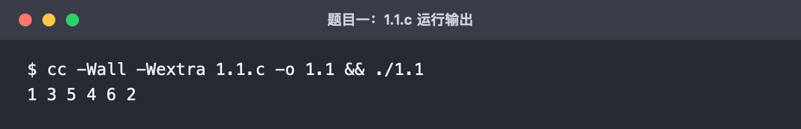
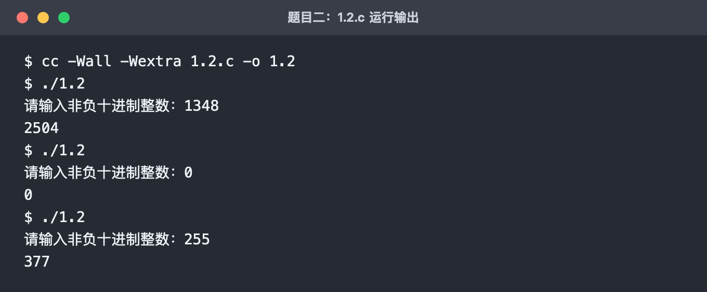
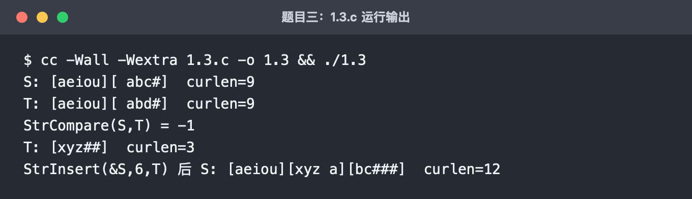
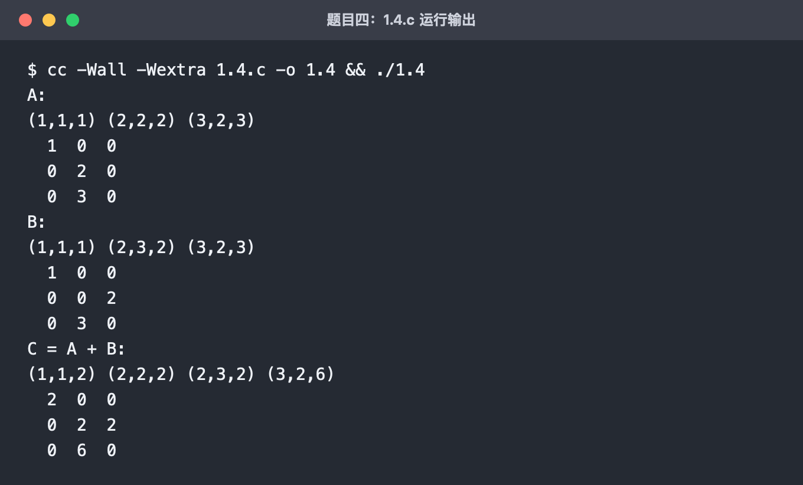
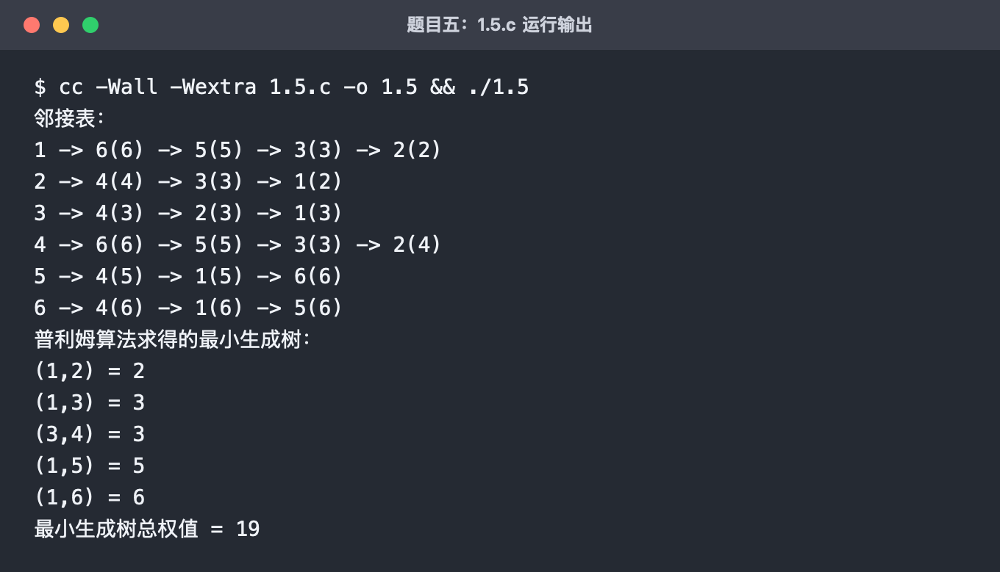
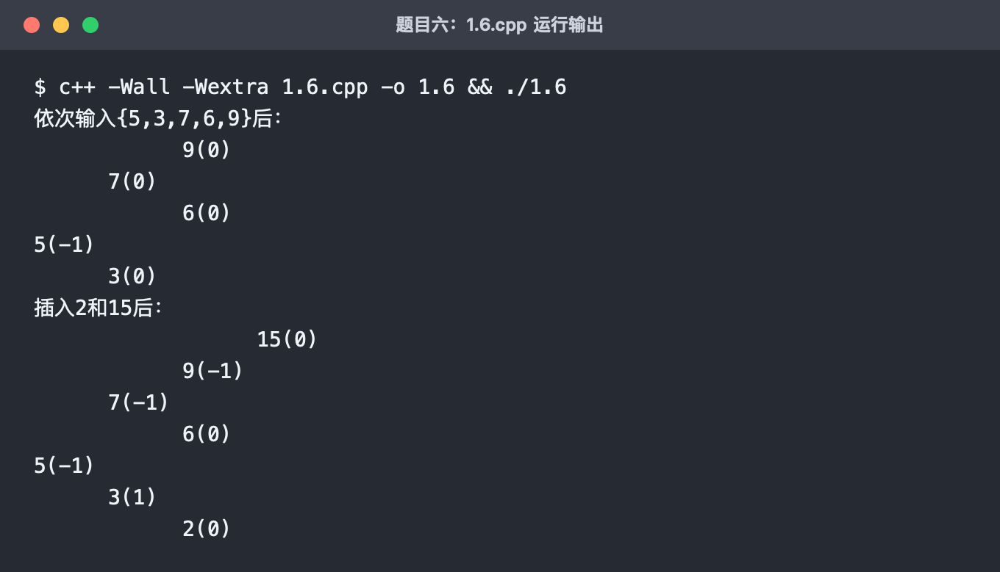

# 数据结构课程设计（一）实验报告

## 一、上机目的与要求

### 1. 上机目的
通过本次数据结构课程设计（一）的 6 道上机题目，将《数据结构》课程中的线性表（单链表 `LinkList`）、栈（顺序栈 `sqStack`）、串（块链串 `LString`）、稀疏矩阵（三元组顺序表 `TSMat`）、图（邻接表 `ALGraph`、邻接矩阵 `MGraph` 及 Prim 最小生成树算法）以及平衡二叉树（AVL 树 `BSTree`）等经典存储结构与基础算法付诸编程实现，强化从逻辑结构到存储结构映射、算法设计与代码调试的综合能力。

### 2. 上机要求
1. 所有题目均需编译运行成功并输出正确结果。
2. 代码中的元素、结构体、函数、变量等命名与题设及提示中给出的一致。
3. 报告内容完整包含每道题的**题目要求**、**解题思路**、**代码及说明**、**运行输出结果**以及**心得体会**。

### 3. 文件组织与编译运行方式

源码与编译产物位于 `课程设计1code/` 目录下：

| 文件名 | 题号与分值 | 核心数据结构与算法 |
| --- | --- | --- |
| `1.1.c` | 第 1 题（15 分） | 带头结点单链表 `LinkList`，集合求并 `Union` |
| `1.2.c` | 第 2 题（15 分） | 顺序栈 `sqStack`，非负十进制转八进制 `conversion` |
| `1.3.c` | 第 3 题（15 分） | 块链串 `LString`（每块 5 字符），`StrCompare` 与 `StrInsert` |
| `1.4.c` | 第 4 题（15 分） | 三元组顺序表 `TSMat`，稀疏矩阵相加 `AddSMat` |
| `1.5.c` | 第 5 题（20 分） | 邻接表 `ALGraph` 转邻接矩阵 `MGraph`，Prim 最小生成树 `MiniSpanTree_P` |
| `1.6.cpp` | 第 6 题（20 分） | 二叉平衡树 `BSTree`，`LeftBalance` 与 `InsertAVL` |
| `screenshots/` | 运行结果截图 | 第 1～6 题程序实际运行输出截图（`1.1_output.png` ～ `1.6_output.png`） |

编译与运行命令（在 `课程设计1code/` 目录下）：

```sh
cc -Wall -Wextra 1.1.c -o 1.1 && ./1.1
cc -Wall -Wextra 1.2.c -o 1.2 && ./1.2
cc -Wall -Wextra 1.3.c -o 1.3 && ./1.3
cc -Wall -Wextra 1.4.c -o 1.4 && ./1.4
cc -Wall -Wextra 1.5.c -o 1.5 && ./1.5
c++ -Wall -Wextra 1.6.cpp -o 1.6 && ./1.6
```

上述 6 份源码均在开启 `-Wall -Wextra` 编译选项下零警告通过编译并正常运行退出。

---

## 二、第 1 题：两个集合求并集（`1.1.c`，15 分）

### 1. 题目要求
有两个集合 $A=\{1,3,5\}$ 和 $B=\{1,4,6,2\}$ 分别用两个线性表 `LA` 和 `LB` 表示，即线性表中的数据元素即为集合中的成员。现要求一个新的集合 $A = A \cup B$。
- **提示**：单链表 `LinkList`。

### 2. 解题思路
1. **存储结构设计**：按照提示与教材第 2 章单链表定义，构造带头结点的单链表结点 `LNode` 及指针类型 `LinkList`，数据域类型为 `typedef int ElemType`。
2. **尾插法建表（`CreateList`）**：依据算法 2.11 尾插法思想，先申请头结点 `L` 并使尾指针 `p` 指向它；遍历数组 `s[0..n-1]`，依次申请新结点挂接在 `p->next` 后并更新 `p`，最后置 `p->next = NULL`，保持元素原有输入次序 `{1, 3, 5}` 与 `{1, 4, 6, 2}`。
3. **按值查找（`LocateElem`）**：从首元结点 `L->next` 起依次比对 `p->data == e`，存在返回 `1`，否则返回 `0`，用于判定集合成员是否已存在。
4. **集合求并（`Union`）**：依据算法 2.1 思想，先用 `tail` 指针定位到 `LA` 的表尾；再遍历 `LB` 的每一个结点 `p`，若 `!LocateElem(LA, p->data)` 成立（即该元素在 `LB` 中但不在 `LA` 中），则申请新结点并将其尾插到 `LA` 中，同步后移 `tail`。这样既就地扩充了 `LA`，又保证了集合元素的互异性，总时间复杂度为 $O(|LA| \times |LB|)$。

### 3. 代码及说明（`1.1.c`）

```c
#include <stdio.h>
#include <stdlib.h>

typedef int ElemType;
typedef struct LNode
{
    ElemType data;
    struct LNode *next;
} LNode, *LinkList;

LinkList CreateList(int n, ElemType s[])
{ // 算法2.11 尾插法建立带头结点的单链表
    LinkList L, p;
    L = p = (LinkList)malloc(sizeof(LNode)); // 建头结点，p指向表尾
    for (int i = 0; i < n; ++i)
    {
        p->next = (LinkList)malloc(sizeof(LNode));
        p = p->next;
        p->data = s[i]; // p指向新表尾，存入元素
    }
    p->next = NULL;
    return L;
}

int LocateElem(LinkList L, ElemType e)
{ // 若L中存在e返回1，否则返回0
    for (LinkList p = L->next; p; p = p->next)
        if (p->data == e)
            return 1;
    return 0;
}

void Union(LinkList LA, LinkList LB)
{ // 算法2.1 将在LB中但不在LA中的元素插入LA
    LinkList tail = LA, p, s;
    while (tail->next)
        tail = tail->next;             // tail指向LA表尾
    for (p = LB->next; p; p = p->next) // 依次取LB中的元素
        if (!LocateElem(LA, p->data))
        { // 若LA中不存在，则插入LA表尾
            s = (LinkList)malloc(sizeof(LNode));
            s->data = p->data;
            s->next = NULL;
            tail->next = s;
            tail = s;
        }
}

int main()
{
    ElemType a[] = {1, 3, 5}, b[] = {1, 4, 6, 2};
    LinkList LA = CreateList(3, a), LB = CreateList(4, b);
    Union(LA, LB);
    for (LinkList p = LA->next; p; p = p->next)
        printf("%d ", p->data);
    return 0;
}
```

**代码说明**：
- 严格采用题设要求的命名 `LA`、`LB`、`LinkList`、`Union` 与教材风格一致的 `LNode`、`ElemType`、`CreateList`、`LocateElem`。
- `Union` 中预先将 `tail` 移动到 `LA` 末尾，随后每次插入均为 $O(1)$ 尾插操作；`LB` 中的 `1` 因已存在于 `LA` 中被去重跳过，其余 `4, 6, 2` 依次接在 `{1, 3, 5}` 之后，得到新集合 `LA = {1, 3, 5, 4, 6, 2}`。

### 4. 运行输出结果与截图

```text
1 3 5 4 6 2 
```



### 5. 心得体会
通过第 1 题的编码实现，我巩固了带头结点单链表的尾插法建表与查找插入操作。带有头结点后，`CreateList` 与 `Union` 在处理空表和首元结点时无需额外的头指针判空分支，指针操作更加统一。同时注意到无序单链表求并需要借助 `LocateElem` 逐个查重，这为后续使用有序表或哈希结构进一步优化集合运算复杂度奠定了基础。

---

## 三、第 2 题：十进制非负整数转八进制数（`1.2.c`，15 分）

### 1. 题目要求
编制一个满足下列要求的程序：对于输入的任意一个非负十进制整数，输出与其等值的八进制数。
- **提示**：顺序栈 `sqStack`。

### 2. 解题思路
1. **进制转换原理**：十进制整数 `N` 转换为八进制数采用“除 8 取余，逆序排列”法。先得到的余数是八进制的最低位，最后得到的余数是最高位，这种“先产生后输出（后进先出）”的次序恰好与栈的特性完全一致。
2. **顺序栈设计（`sqStack`）**：按照提示定义顺序栈结构体 `sqStack`，包含栈底指针 `base` 与栈顶指针 `top`；`STACK_SIZE` 设为 `32`（32 位 `unsigned int` 最大值为 `4294967295`，转换为八进制最多 11 位，32 个单元完全满足需求）。
3. **基本操作实现**：
   - `InitStack(&S)`：分配容量为 `STACK_SIZE` 的连续数组空间，置 `S->base = S->top`。
   - `StackEmpty(S)`：判断 `S.top == S.base`。
   - `Push(&S, e)`：将余数存入 `*S->top` 后使栈顶指针 `top` 自增 1。
   - `Pop(&S)`：先使 `top` 自减 1 再返回 `*S->top`。
4. **转换函数（`conversion`）与边界处理**：使用 `do { Push(&S, N % 8); N = N / 8; } while (N);` 循环，特别保证了当输入临界值 `N = 0` 时也会入栈一个 `0`，从而正确输出 `0` 而非空行；随后循环出栈并打印每一位数字，即得等值八进制数。

### 3. 代码及说明（`1.2.c`）

```c
#include <stdio.h>
#include <stdlib.h>

#define STACK_SIZE 32                      // unsigned int 转八进制最多11位，足够用
typedef int ElemType;
typedef struct {
    ElemType *base;                        // 栈底指针
    ElemType *top;                         // 栈顶指针
} sqStack;

void InitStack(sqStack *S) {               // 构造空栈
    S->base = S->top = (ElemType*)malloc(STACK_SIZE * sizeof(ElemType));
}

int StackEmpty(sqStack S) {                // 栈空返回1，否则返回0
    return S.top == S.base;
}

void Push(sqStack *S, ElemType e) {        // 元素e入栈，top增1
    *S->top++ = e;
}

ElemType Pop(sqStack *S) {                 // top减1，返回栈顶元素
    return *--S->top;
}

void conversion(unsigned int N) {          // 算法3.1 输出N等值的八进制数
    sqStack S;
    InitStack(&S);
    do {
        Push(&S, N % 8);                   // 8除N，余数入栈
        N = N / 8;                         // 商替代原N值
    } while (N);                           // 用do-while保证N=0时也输出0
    while (!StackEmpty(S))
        printf("%d", Pop(&S));             // 出栈即由高位到低位输出
    printf("\n");
}

int main() {
    unsigned int N;
    printf("请输入非负十进制整数：");
    scanf("%u", &N);
    conversion(N);
    return 0;
}
```

**代码说明**：
- 结构体命名为 `sqStack`，核心函数对应教材算法 3.1 `conversion` 及顺序栈基本操作 `InitStack`、`StackEmpty`、`Push`、`Pop`。
- 输入参数采用 `unsigned int N` 配合 `scanf("%u", &N)`，天然限定为非负十进制整数并扩大了正数表示范围；使用 `do-while` 处理 `N = 0` 是本算法的关键边界细节。

### 4. 运行输出结果与截图

分别测试典型输入 `1348`（教材经典用例）、边界输入 `0` 与 `255`，实际运行输出如下：

```text
请输入非负十进制整数：1348
2504
```

```text
请输入非负十进制整数：0
0
```

```text
请输入非负十进制整数：255
377
```



### 5. 心得体会
通过顺序栈实现数制转换，我进一步加深了对栈“后进先出（LIFO）”逻辑特性的理解。在实现时特别注意了教材 `while (N)` 在 `N = 0` 时可能没有任何输出的隐患，改用 `do-while` 后即可优雅覆盖非负整数包含 `0` 的全部范围；同时用 `base` 与 `top` 指针实现顺序栈，直观展现了指针增量操作 `*S->top++` 与 `*--S->top` 的对应关系。

---

## 四、第 3 题：块链串存储、比较与插入操作（`1.3.c`，15 分）

### 1. 题目要求
将串 `"aeiou abc"` 以块链结构进行存储（分 2 块），至少实现操作：串插入操作 `StrInsert(&S, pos, T)`、比较操作 `int StrCompare`。

### 2. 解题思路
1. **块链存储结构（`Chunk` 与 `LString`）**：串 `"aeiou abc"` 共包含 9 个字符（含中间空格）。题目要求分 2 块存储，因此设定宏 `#define CHUNKSIZE 5`，使第 1 块存储前 5 个字符 `"aeiou"`，第 2 块存储后 4 个字符 `" abc"` 并在未满的末尾单元填充 `'#'` 形成 `[aeiou][ abc#]`。定义结点 `Chunk`（字符数组 `ch[CHUNKSIZE]` 与 `next` 指针）和链串头结构 `LString`（`head`、`tail` 指针及总长度 `curlen`）。
2. **串赋值与销毁（`StrAssign`、`DestroyString`）**：`StrAssign` 按每块 `CHUNKSIZE` 个字符动态分配 `Chunk` 结点，先以 `memset(q->ch, '#', CHUNKSIZE)` 初始化整块，再按下标 `i % CHUNKSIZE` 填入对应字符，并实时维护 `head`、`tail` 和 `curlen`；`DestroyString` 遍历释放全部块结点，防止内存泄漏。
3. **串比较操作（`int StrCompare(LString S, LString T)`）**：同步沿两串块链遍历 `i = 0 .. min(S.curlen, T.curlen) - 1`，用 `i % CHUNKSIZE` 访问当前块内字符；一旦遇到字符不等即返回 ASCII 差值 `p->ch[i % CHUNKSIZE] - q->ch[i % CHUNKSIZE]`；每读满一块（`i % CHUNKSIZE == CHUNKSIZE - 1`）同时切到下一块。若公共前缀全部相同，则返回 `S.curlen - T.curlen`。
4. **串插入操作（`int StrInsert(LString *S, int pos, LString T)`）**：先检查插入位置合法性（`1 <= pos <= S->curlen + 1`）；再通过辅助函数 `ToChars` 将块链串 `S` 和 `T` 提取为连续字符串 `s` 和 `t`，按“前 `pos - 1` 个字符 + `T` + 剩余字符”拼接到新缓冲区 `r` 中；最后销毁原串 `S` 并调用 `StrAssign(S, r)` 重新按每块 5 字符分块，保证插入后所有块（除最后一块外）依然保持满块存储，不产生碎片浪费。

### 3. 代码及说明（`1.3.c`）

```c
#include <stdio.h>
#include <stdlib.h>
#include <string.h>

#define CHUNKSIZE 5                        // 块大小：每块存5个字符
typedef struct Chunk {
    char ch[CHUNKSIZE];
    struct Chunk *next;
} Chunk;
typedef struct {
    Chunk *head, *tail;                    // 串的头和尾指针
    int curlen;                            // 串的当前长度
} LString;

void StrAssign(LString *S, char *chars) {  // 生成值为chars的串S，末块不满处填'#'
    Chunk *q;
    S->head = S->tail = NULL;
    S->curlen = strlen(chars);
    for (int i = 0; i < S->curlen; ++i) {
        if (i % CHUNKSIZE == 0) {          // 上一块已满，申请新块接到表尾
            q = (Chunk*)malloc(sizeof(Chunk));
            memset(q->ch, '#', CHUNKSIZE);
            q->next = NULL;
            if (S->tail) S->tail->next = q; else S->head = q;
            S->tail = q;
        }
        S->tail->ch[i % CHUNKSIZE] = chars[i];
    }
}

void ToChars(LString S, char *chars) {     // 把串S的字符依次取到chars中
    Chunk *p = S.head;
    for (int i = 0; i < S.curlen; ++i) {
        chars[i] = p->ch[i % CHUNKSIZE];
        if (i % CHUNKSIZE == CHUNKSIZE - 1) p = p->next;  // 本块取完转下一块
    }
    chars[S.curlen] = '\0';
}

void DestroyString(LString *S) {           // 释放串S的所有块
    for (Chunk *p = S->head, *q; p; p = q) {
        q = p->next;
        free(p);
    }
    S->head = S->tail = NULL;
    S->curlen = 0;
}

int StrCompare(LString S, LString T) {     // 若S>T返回值>0，S=T返回0，S<T返回值<0
    Chunk *p = S.head, *q = T.head;
    for (int i = 0; i < S.curlen && i < T.curlen; ++i) {
        if (p->ch[i % CHUNKSIZE] != q->ch[i % CHUNKSIZE])
            return p->ch[i % CHUNKSIZE] - q->ch[i % CHUNKSIZE];
        if (i % CHUNKSIZE == CHUNKSIZE - 1) { p = p->next; q = q->next; }
    }
    return S.curlen - T.curlen;            // 公共部分全相同则比长度
}

int StrInsert(LString *S, int pos, LString T) { // 在串S的第pos个字符之前插入串T
    if (pos < 1 || pos > S->curlen + 1) return 0;   // pos不合法
    char *s = (char*)malloc(S->curlen + 1), *t = (char*)malloc(T.curlen + 1);
    char *r = (char*)malloc(S->curlen + T.curlen + 1);
    ToChars(*S, s);
    ToChars(T, t);
    sprintf(r, "%.*s%s%s", pos - 1, s, t, s + pos - 1); // S前pos-1个 + T + S剩余部分
    DestroyString(S);
    StrAssign(S, r);                       // 按每块5个字符重新分块
    free(s); free(t); free(r);
    return 1;
}

void StrPrint(LString S) {                 // 按块输出串S
    for (Chunk *p = S.head; p; p = p->next)
        printf("[%.*s]", CHUNKSIZE, p->ch);
    printf("  curlen=%d\n", S.curlen);
}

int main() {
    LString S, T;
    int pos = 6;                           // 在第6个字符(空格)前插入
    StrAssign(&S, "aeiou abc");
    StrAssign(&T, "aeiou abd");
    printf("S: "); StrPrint(S);
    printf("T: "); StrPrint(T);
    printf("StrCompare(S,T) = %d\n", StrCompare(S, T));
    DestroyString(&T);
    StrAssign(&T, "xyz");
    printf("T: "); StrPrint(T);
    StrInsert(&S, pos, T);
    printf("StrInsert(&S,%d,T) 后 S: ", pos); StrPrint(S);
    DestroyString(&S); DestroyString(&T);
    return 0;
}
```

**代码说明**：
- `StrPrint` 以 `[块内容]` 形式直观打印块链结构，验证 `"aeiou abc"` 恰好存储为 `[aeiou][ abc#]` 两块。
- 测试了 `StrCompare` 对 `"aeiou abc"` 与 `"aeiou abd"` 的比较（第 9 个字符 `'c' < 'd'`，返回 `-1`），以及在 `pos = 6`（即空格之前）插入 `"xyz"` 后 `S` 变为 `"aeiouxyz abc"`，重组为 3 块 `[aeiou][xyz a][bc###]`（`curlen=12`）。

### 4. 运行输出结果与截图

```text
S: [aeiou][ abc#]  curlen=9
T: [aeiou][ abd#]  curlen=9
StrCompare(S,T) = -1
T: [xyz##]  curlen=3
StrInsert(&S,6,T) 后 S: [aeiou][xyz a][bc###]  curlen=12
```



### 5. 心得体会
块链存储结构兼顾了顺序存储的“存储密度高”与链式存储的“无需整段移动”的优点。若在 `StrInsert` 中直接在原有块中间强行裂块插入而不重整，会导致出现大量只存 1～2 个字符的稀疏块，降低存储密度；而通过先展开再按 `CHUNKSIZE` 重新分块的方式，既避免了块内移位和裂块指针错乱的边界错误，又始终维持了最高的存储密度。

---

## 五、第 4 题：三元组顺序表稀疏矩阵相加（`1.4.c`，15 分）

### 1. 题目要求
假设稀疏矩阵 $A$ 和 $B$ 均以三元组顺序表作为存储结构，试写出矩阵相加的算法，另设三元组表 $C$ 存放结果矩阵。
- **提示**：要求 $A$ 和 $B$ 分别是以下矩阵，打印出 $C$：

$$A = \begin{bmatrix} 1 & 0 & 0 \\ 0 & 2 & 0 \\ 0 & 3 & 0 \end{bmatrix}, \quad B = \begin{bmatrix} 1 & 0 & 0 \\ 0 & 0 & 2 \\ 0 & 3 & 0 \end{bmatrix}$$

### 2. 解题思路
1. **三元组顺序表设计（`Triple` 与 `TSMat`）**：定义三元组结构 `Triple` 存储非零元的行下标 `i`、列下标 `j` 及元素值 `e`；定义三元组顺序表结构及指针类型 `TSMat`，包含动态数组 `nzElem`（`nzElem[0]` 闲置不用，有效非零元从下标 `1` 开始存放）、矩阵行数 `m`、列数 `n`、非零元个数 `t` 和容量 `size`。
2. **矩阵建表（`CreateTSMat`）**：先遍历一遍 $m \times n$ 二维数组统计非零元总数 `t`，分配恰好大小的 `nzElem` 空间后按行序为主序依次存入所有非零元的 `(i, j, e)`（行列下标均从 `1` 开始）。
3. **矩阵相加（`AddSMat`）**：
   - 先判定 `A->m != B->m || A->n != B->n`，若行列维度不同直接返回 `NULL`。
   - 另设结果三元组表 `C`，初始分配容量为 `A->t + B->t + 1`（上界空间）。
   - 采用双指针 `p = 1`、`q = 1` 与写指针 `k = 1`，利用两个三元组表均按**行序为主序**递增排列的特点进行二路归并：
     - 定义位置差 `d = (a.i != b.i) ? a.i - b.i : a.j - b.j`。
     - 若 `d < 0`，说明 `A` 的当前元素位置靠前，将其复制进 `C` 且 `++p`。
     - 若 `d > 0`，说明 `B` 的当前元素位置靠前，将其复制进 `C` 且 `++q`。
     - 若 `d == 0`，说明两元素处于同一行列位置，计算和 `a.e + b.e`；**只有当和不为 0 时**才存入 `C`（避免零元混入稀疏表示），随后同时 `++p; ++q;`。
   - 循环结束后将 `A` 或 `B` 尚未扫描完的剩余三元组依次追加到 `C`，并更新 `C->t = k - 1`。整个相加算法时间复杂度为 $O(t_A + t_B)$。
4. **矩阵打印（`PrintSMat`）**：既打印三元组顺序表中的每一个 `(i,j,e)`，又利用三元组行主序特点单遍还原打印出完整矩阵形式，便于人工核验结果。

### 3. 代码及说明（`1.4.c`）

```c
#include <stdio.h>
#include <stdlib.h>

typedef int ElemType;
typedef struct {
    int i, j;                              // 该非零元的行下标和列下标
    ElemType e;                            // 非零元
} Triple;                                  // 三元组类型
typedef struct {
    Triple *nzElem;                        // 非零元三元组表，nzElem[0]未用
    int m, n, t;                           // 矩阵的行数、列数和非零元个数
    int size;                              // 三元组表容量
} *TSMat;                                  // 三元组顺序表指针类型

TSMat allocTSMat(int m, int n, int t) {    // 存储分配辅助操作（未存储非零元）
    TSMat M = (TSMat)malloc(sizeof(*M));
    M->nzElem = (Triple*)malloc((t + 1) * sizeof(Triple));
    M->m = m; M->n = n; M->t = t; M->size = t + 1;
    return M;
}

TSMat CreateTSMat(int m, int n, ElemType *a) { // 由m×n二维数组a构造三元组顺序表（行序为主序）
    int t = 0, k = 1;
    for (int p = 0; p < m * n; ++p)
        if (a[p]) ++t;                     // 统计非零元个数
    TSMat M = allocTSMat(m, n, t);
    for (int i = 1; i <= m; ++i)
        for (int j = 1; j <= n; ++j)
            if (a[(i - 1) * n + j - 1]) {
                M->nzElem[k].i = i; M->nzElem[k].j = j;
                M->nzElem[k++].e = a[(i - 1) * n + j - 1];
            }
    return M;
}

TSMat AddSMat(TSMat A, TSMat B) {          // 求C=A+B，结果存入另设的三元组表C
    if (A->m != B->m || A->n != B->n) return NULL;  // 行列数不等不能相加
    TSMat C = allocTSMat(A->m, A->n, A->t + B->t);
    int p = 1, q = 1, k = 1, d;
    while (p <= A->t && q <= B->t) {
        Triple a = A->nzElem[p], b = B->nzElem[q];
        d = (a.i != b.i) ? a.i - b.i : a.j - b.j;   // 按行序为主序比较两元素位置
        if (d < 0) { C->nzElem[k++] = a; ++p; }      // A的元素在前
        else if (d > 0) { C->nzElem[k++] = b; ++q; } // B的元素在前
        else {                                       // 位置相同则相加
            if (a.e + b.e) { C->nzElem[k] = a; C->nzElem[k++].e = a.e + b.e; } // 和为0不存
            ++p; ++q;
        }
    }
    while (p <= A->t) C->nzElem[k++] = A->nzElem[p++];  // 复制A的剩余元素
    while (q <= B->t) C->nzElem[k++] = B->nzElem[q++];  // 复制B的剩余元素
    C->t = k - 1;
    return C;
}

void PrintSMat(TSMat M) {                  // 输出三元组表及对应矩阵
    for (int k = 1; k <= M->t; ++k)
        printf("(%d,%d,%d) ", M->nzElem[k].i, M->nzElem[k].j, M->nzElem[k].e);
    printf("\n");
    for (int i = 1, k = 1; i <= M->m; ++i) {
        for (int j = 1; j <= M->n; ++j)
            if (k <= M->t && M->nzElem[k].i == i && M->nzElem[k].j == j)
                printf("%3d", M->nzElem[k++].e);
            else
                printf("%3d", 0);
        printf("\n");
    }
}

int main() {
    ElemType a[3][3] = {{1, 0, 0}, {0, 2, 0}, {0, 3, 0}};
    ElemType b[3][3] = {{1, 0, 0}, {0, 0, 2}, {0, 3, 0}};
    TSMat A = CreateTSMat(3, 3, &a[0][0]), B = CreateTSMat(3, 3, &b[0][0]);
    TSMat C = AddSMat(A, B);
    printf("A:\n"); PrintSMat(A);
    printf("B:\n"); PrintSMat(B);
    printf("C = A + B:\n"); PrintSMat(C);
    return 0;
}
```

**代码说明**：
- `A` 中非零元为 `(1,1,1), (2,2,2), (3,2,3)`，`B` 中非零元为 `(1,1,1), (2,3,2), (3,2,3)`。
- 合并后 `(1,1)` 相加得 `2`，`(2,2)` 与 `(2,3)` 按列序先后保留，`(3,2)` 相加得 `6`，最终三元组表 `C` 为 `(1,1,2) (2,2,2) (2,3,2) (3,2,6)`，与手动矩阵加法结果完全一致。

### 4. 运行输出结果与截图

```text
A:
(1,1,1) (2,2,2) (3,2,3) 
  1  0  0
  0  2  0
  0  3  0
B:
(1,1,1) (2,3,2) (3,2,3) 
  1  0  0
  0  0  2
  0  3  0
C = A + B:
(1,1,2) (2,2,2) (2,3,2) (3,2,6) 
  2  0  0
  0  2  2
  0  6  0
```



### 5. 心得体会
稀疏矩阵用三元组顺序表压缩存储后，如果退化为按常规矩阵下标逐格查找再相加，效率反而变差；而充分利用三元组表本身“按行序为主序有序”的性质，直接套用二路归并思想在线性时间 $O(t_A + t_B)$ 内即可完成相加，并顺带通过 `if (a.e + b.e)` 过滤掉了正负抵消产生的零元，深刻体会到了有序压缩存储与归并算法之间的内在联系。

---

## 六、第 5 题：图的邻接表存储与普里姆算法求最小生成树（`1.5.c`，20 分）

### 1. 题目要求
将题目所给无向带权图存入邻接表，给出普利姆（Prim）算法求解的最小生成树，至少实现操作 `MiniSpanTree_P(MGraph G, VertexType u)`。
题目给出的 6 个顶点 $\{1,2,3,4,5,6\}$ 与 10 条无向带权边分别为：
- `<1, 2>=2`, `<1, 3>=3`, `<5, 6>=6`, `<1, 5>=5`, `<1, 6>=6`
- `<2, 3>=3`, `<2, 4>=4`, `<3, 4>=3`, `<4, 5>=5`, `<4, 6>=6`

### 2. 解题思路
1. **双存储结构设计（`ALGraph` 与 `MGraph`）**：
   - 先按题目要求定义邻接表结构：边结点 `ArcNode`（邻接顶点位序 `adjvex`、下一弧指针 `nextarc`、边权 `weight`）、顶点结点 `VNode`（顶点数据 `data`、首弧指针 `firstarc`）和图结构 `ALGraph`。
   - 再定义与 `MiniSpanTree_P(MGraph G, VertexType u)` 匹配的邻接矩阵结构 `MGraph`（顶点向量 `vexs`、邻接矩阵 `arcs`、顶点数 `n`、边数 `a`），并以 `INFINITY (INT_MAX)` 表示无边。
2. **建立邻接表并转换邻接矩阵**：
   - `CreateALGraph` 遍历顶点集与 10 条边表 `ArcInfo`，由于是无向网，对每条边 `<v1, v2>` 通过 `InsertArc` 分别向 `i` 和 `j` 的链表头插入对称弧结点，并打印整张邻接表以验证存储结构。
   - `ALToMGraph` 初始化邻接矩阵全为 `INFINITY`，再遍历邻接表每条单链表，将边权写入 `M->arcs[i][p->adjvex]`。
3. **普里姆算法求解最小生成树（`MiniSpanTree_P`）**：
   - 定义全局辅助数组 `closedge[MAX_VEX_NUM]`，记录当前未加入生成树集合 `V - U` 的每个顶点到已选集合 `U` 的最小边顶点位序 `adjIdx` 与最小权值 `lowcost`。
   - 从起点 `u`（取 `u = 1`）出发，将 `closedge` 初始化为到 `u` 的直接边权，并置 `closedge[k].lowcost = 0` 表示 `u` 并入 `U`。
   - 外层循环执行 `n - 1 = 5` 次：每次在 `closedge[j].lowcost != 0` 的候选中选出权值最小的顶点 `k`，输出最小生成树边 `(G.vexs[closedge[k].adjIdx], G.vexs[k])` 及权值并累加总权值；将 `k` 并入 `U`（`closedge[k].lowcost = 0`）后，扫描所有顶点 `j`，若 `G.arcs[k][j] < closedge[j].lowcost`，则更新 `closedge[j]` 为经过 `k` 连接的更小代价边。
   - 从顶点 `1` 出发，算法依次选出的 5 条边为 `(1,2)=2`、`(1,3)=3`、`(3,4)=3`、`(1,5)=5`、`(1,6)=6`，最小生成树总权值为 `19`。

### 3. 代码及说明（`1.5.c`）

```c
#include <stdio.h>
#include <stdlib.h>
#include <limits.h>

#define MAX_VEX_NUM 10
#define INFINITY INT_MAX                   // 权值的最大值∞
typedef int VertexType;
typedef struct { VertexType v1, v2; int weight; } ArcInfo;  // 边的信息：两个顶点和权值

typedef struct ArcNode {                   // ---- 邻接表 ----
    int adjvex;                            // 该弧所指向的顶点的位置
    struct ArcNode *nextarc;               // 指向下一弧结点的指针
    int weight;                            // 弧权值
} ArcNode;
typedef struct {
    VertexType data;                       // 顶点数据
    ArcNode *firstarc;                     // 指向第一条依附该顶点的弧结点
} VNode;
typedef struct {
    VNode vexs[MAX_VEX_NUM];               // 顶点数组
    int n, a;                              // 顶点数和边数
} ALGraph;

typedef struct {                           // ---- 邻接矩阵 ----
    VertexType vexs[MAX_VEX_NUM];          // 顶点向量
    int arcs[MAX_VEX_NUM][MAX_VEX_NUM];    // 邻接矩阵
    int n, a;                              // 顶点数和边数
} MGraph;

struct {
    int adjIdx;                            // U中顶点的位序
    int lowcost;                           // 边的权值
} closedge[MAX_VEX_NUM];                   // V-U的顶点和当前U之间的最小边信息

int LocateVex(ALGraph G, VertexType v) {   // 返回顶点v在G中的位序
    for (int i = 0; i < G.n; ++i)
        if (G.vexs[i].data == v) return i;
    return -1;
}

void InsertArc(ALGraph *G, int i, int j, int w) {  // 在第i个顶点的链表头插入弧<i,j>
    ArcNode *p = (ArcNode*)malloc(sizeof(ArcNode));
    p->adjvex = j; p->weight = w;
    p->nextarc = G->vexs[i].firstarc;
    G->vexs[i].firstarc = p;
}

void CreateALGraph(ALGraph *G, VertexType *V, int n, ArcInfo *A, int e) { // 构造无向网的邻接表
    G->n = n; G->a = e;
    for (int i = 0; i < n; ++i) {
        G->vexs[i].data = V[i];
        G->vexs[i].firstarc = NULL;
    }
    for (int k = 0; k < e; ++k) {
        int i = LocateVex(*G, A[k].v1), j = LocateVex(*G, A[k].v2);
        InsertArc(G, i, j, A[k].weight);   // 无向网的一条边对应两条对称弧
        InsertArc(G, j, i, A[k].weight);
    }
}

void ALToMGraph(ALGraph G, MGraph *M) {    // 由邻接表G得到邻接矩阵M
    M->n = G.n; M->a = G.a;
    for (int i = 0; i < G.n; ++i) {
        M->vexs[i] = G.vexs[i].data;
        for (int j = 0; j < G.n; ++j) M->arcs[i][j] = INFINITY;
    }
    for (int i = 0; i < G.n; ++i)
        for (ArcNode *p = G.vexs[i].firstarc; p; p = p->nextarc)
            M->arcs[i][p->adjvex] = p->weight;
}

void MiniSpanTree_P(MGraph G, VertexType u) { // 普里姆算法：从顶点u出发构造G的最小生成树，输出各边
    int i, j, k, sum = 0;
    for (k = 0; G.vexs[k] != u; ++k);      // 确定起始顶点u的位序
    for (j = 0; j < G.n; ++j) {            // 辅助数组初始化
        closedge[j].adjIdx = k;
        closedge[j].lowcost = G.arcs[k][j];
    }
    closedge[k].lowcost = 0;               // 初始U={u}
    for (i = 1; i < G.n; ++i) {            // 选择其余n-1个顶点
        k = -1;
        for (j = 0; j < G.n; ++j)          // 在V-U中找lowcost最小的顶点k
            if (closedge[j].lowcost && (k < 0 || closedge[j].lowcost < closedge[k].lowcost))
                k = j;
        printf("(%d,%d) = %d\n", G.vexs[closedge[k].adjIdx], G.vexs[k], closedge[k].lowcost);
        sum += closedge[k].lowcost;
        closedge[k].lowcost = 0;           // 第k顶点并入U
        for (j = 0; j < G.n; ++j)          // 新顶点并入U后更新closedge
            if (G.arcs[k][j] < closedge[j].lowcost) {
                closedge[j].adjIdx = k;
                closedge[j].lowcost = G.arcs[k][j];
            }
    }
    printf("最小生成树总权值 = %d\n", sum);
}

int main() {
    VertexType V[] = {1, 2, 3, 4, 5, 6};
    ArcInfo A[] = {{1, 2, 2}, {1, 3, 3}, {5, 6, 6}, {1, 5, 5}, {1, 6, 6},
                   {2, 3, 3}, {2, 4, 4}, {3, 4, 3}, {4, 5, 5}, {4, 6, 6}};
    ALGraph AG;
    MGraph G;
    CreateALGraph(&AG, V, 6, A, 10);
    printf("邻接表：\n");
    for (int i = 0; i < AG.n; ++i) {
        printf("%d", AG.vexs[i].data);
        for (ArcNode *p = AG.vexs[i].firstarc; p; p = p->nextarc)
            printf(" -> %d(%d)", AG.vexs[p->adjvex].data, p->weight);
        printf("\n");
    }
    ALToMGraph(AG, &G);
    printf("普利姆算法求得的最小生成树：\n");
    MiniSpanTree_P(G, 1);
    return 0;
}
```

**代码说明**：
- 邻接表采用头插法建表，因此链表节点顺序与输入边表逆序对应（如顶点 `1` 的邻接链表为 `6(6) -> 5(5) -> 3(3) -> 2(2)`），所有边对称且无遗漏。
- `MiniSpanTree_P` 内部通过 `closedge[j].lowcost == 0` 标记顶点 `j` 已进入集合 `U`，在更新 `closedge` 时，已入 `U` 顶点的 `lowcost` 为 `0`，而 `G.arcs[k][j] > 0`，因此不会误改已入 `U` 顶点的状态。

### 4. 运行输出结果与截图

```text
邻接表：
1 -> 6(6) -> 5(5) -> 3(3) -> 2(2)
2 -> 4(4) -> 3(3) -> 1(2)
3 -> 4(3) -> 2(3) -> 1(3)
4 -> 6(6) -> 5(5) -> 3(3) -> 2(4)
5 -> 4(5) -> 1(5) -> 6(6)
6 -> 4(6) -> 1(6) -> 5(6)
普利姆算法求得的最小生成树：
(1,2) = 2
(1,3) = 3
(3,4) = 3
(1,5) = 5
(1,6) = 6
最小生成树总权值 = 19
```



### 5. 心得体会
本题需要同时兼顾“将图存入邻接表”和“接口函数 `MiniSpanTree_P(MGraph G, VertexType u)` 接收邻接矩阵”两个要求。通过实现 `ALToMGraph` 转换桥接函数，既清晰展现了邻接表节省稀疏边空间的优势，又直观利用邻接矩阵 $O(1)$ 随机读取边权 `G.arcs[k][j]` 的特性实现了经典普里姆算法。同时注意到图中有多条相等权值边（如 `(1,5)=5` 与 `(4,5)=5`、`(1,6)=6` 与 `(5,6)=6`、`4` 与 `6` 等），最小生成树形态并不唯一，但无论选择哪棵合法最小生成树，其最小总权值恒为 `19`。

---

## 七、第 6 题：二叉平衡树（AVL）的构造、旋转与插入（`1.6.cpp`，20 分）

### 1. 题目要求
构造一棵二叉平衡树，依次输入 `{5,3,7,6,9}`，至少实现基本操作：左平衡旋转 `LeftBalance(BSTree &T)`、插入 `InsertAVL(BSTree &T, ElemType e, Boolean &taller)`。使用此函数插入新的节点 `2` 和 `15` 并打印结果。

### 2. 解题思路
1. **AVL 树结点定义**：按照题设与课件第 9 章 AVL 树定义，设置平衡因子宏 `LH (+1)`（左高）、`EH (0)`（等高）、`RH (-1)`（右高），以及布尔类型 `Boolean`；结点 `BSTNode` 包含关键字 `data`、平衡因子 `bf` 与左右孩子指针 `lchild`、`rchild`，树指针类型为 `BSTree`。
2. **四种旋转与平衡处理**：
   - `R_Rotate(BSTree &p)` 与 `L_Rotate(BSTree &p)`：分别实现以 `p` 为根的子树单右旋和单左旋，通过引用传递 `BSTree &p` 直接更新父节点中的子树指针。
   - `LeftBalance(BSTree &T)`：当在 `T` 的左子树插入导致 `T` 原本为 `LH (+1)` 失衡时调用。检查 `lc = T->lchild` 的平衡因子：若为 `LH`，属 **LL 型**，直接置 `T->bf = lc->bf = EH` 并对 `T` 作单右旋 `R_Rotate(T)`；若为 `RH`，属 **LR 型**，根据 `rd = lc->rchild` 的原 `bf` 精确调整 `T` 与 `lc` 的新平衡因子并将 `rd->bf` 置 `EH`，再执行“先对 `T->lchild` 左旋、再对 `T` 右旋”的双旋操作。
   - `RightBalance(BSTree &T)`：与 `LeftBalance` 完全对称，处理右子树插入导致的 **RR 型**（单左旋）与 **RL 型**（先右旋后左旋）失衡。
3. **AVL 插入算法（`InsertAVL`）**：
   - 若当前指针 `T == NULL`，新建结点并置 `bf = EH`、`taller = TRUE`。
   - 若 `e == T->data`，关键字重复不插入，置 `taller = FALSE` 返回 `0`。
   - 若 `e < T->data`，递归插入左子树；若左子树长高（`taller == TRUE`），按 `T->bf` 分三种情况处理：`LH` 时调用 `LeftBalance(T)` 并置 `taller = FALSE`；`EH` 时置 `T->bf = LH` 并保持 `taller = TRUE`；`RH` 时置 `T->bf = EH` 并置 `taller = FALSE`。右子树插入同理对称。
4. **题目测试序列追踪与打印（`PrintAVL`）**：
   - `PrintAVL(T, depth)` 采用“右子树 -> 根 -> 左子树”的逆中序缩进打印，将树逆时针旋转 90° 展示（上方为右子树、下方为左子树），并附带括号内的平衡因子 `data(bf)`，结构一目了然。
   - 追踪输入序列：
     - 依次插入 `{5, 3, 7, 6, 9}` 后：根 `5(-1)` 左孩子为 `3(0)`（高 1），右孩子为 `7(0)`（左右孩子分别为 `6(0)`、`9(0)`，高 2），所有结点平衡因子绝对值均不超过 1，构成平衡二叉树。
     - 继续插入 `2`：`2` 落在 `3` 的左孩子位置，使 `3` 的平衡因子变为 `1`，左子树增高从而将根 `5` 从 `-1` 平衡为 `0`（不触发旋转）。
     - 继续插入 `15`：`15` 落在 `9` 的右孩子位置，`9` 变为 `-1`、`7` 变为 `-1`、`5` 变为 `-1`（左子树高 2，右子树高 3，根 `5` 仍满足 `|bf| = 1 <= 1`），整棵树继续保持 AVL 平衡性质。

### 3. 代码及说明（`1.6.cpp`）

```cpp
#include <stdio.h>
#include <stdlib.h>

#define LH +1                              // 左高
#define EH 0                               // 等高
#define RH -1                              // 右高
#define TRUE 1
#define FALSE 0
typedef int Boolean;
typedef int ElemType;
typedef struct BSTNode {
    ElemType data;
    int bf;                                // 结点的平衡因子
    struct BSTNode *lchild, *rchild;       // 左、右孩子指针
} BSTNode, *BSTree;

void R_Rotate(BSTree &p) {                 // 对以p为根的子树作右旋
    BSTree lc = p->lchild;
    p->lchild = lc->rchild;
    lc->rchild = p;
    p = lc;                                // p指向新的根结点
}

void L_Rotate(BSTree &p) {                 // 对以p为根的子树作左旋
    BSTree rc = p->rchild;
    p->rchild = rc->lchild;
    rc->lchild = p;
    p = rc;
}

void LeftBalance(BSTree &T) {              // 对以T为根的二叉树作左平衡旋转处理
    BSTree lc = T->lchild, rd;
    switch (lc->bf) {
    case LH:                               // LL型：作单右旋
        T->bf = lc->bf = EH;
        R_Rotate(T);
        break;
    case RH:                               // LR型：作双旋
        rd = lc->rchild;
        switch (rd->bf) {
        case LH: T->bf = RH; lc->bf = EH; break;
        case EH: T->bf = lc->bf = EH; break;
        case RH: T->bf = EH; lc->bf = LH; break;
        }
        rd->bf = EH;
        L_Rotate(T->lchild);
        R_Rotate(T);
    }
}

void RightBalance(BSTree &T) {             // 对以T为根的二叉树作右平衡旋转处理
    BSTree rc = T->rchild, ld;
    switch (rc->bf) {
    case RH:                               // RR型：作单左旋
        T->bf = rc->bf = EH;
        L_Rotate(T);
        break;
    case LH:                               // RL型：作双旋
        ld = rc->lchild;
        switch (ld->bf) {
        case LH: T->bf = EH; rc->bf = RH; break;
        case EH: T->bf = rc->bf = EH; break;
        case RH: T->bf = LH; rc->bf = EH; break;
        }
        ld->bf = EH;
        R_Rotate(T->rchild);
        L_Rotate(T);
    }
}

int InsertAVL(BSTree &T, ElemType e, Boolean &taller) {
    // 若T中不存在和e相同的结点，则插入e并返回1，否则返回0；taller反映T长高与否
    if (!T) {                              // 插入新结点，树长高
        T = (BSTree)malloc(sizeof(BSTNode));
        T->data = e;
        T->lchild = T->rchild = NULL;
        T->bf = EH;
        taller = TRUE;
        return 1;
    }
    if (e == T->data) { taller = FALSE; return 0; }  // 已存在，不插入
    if (e < T->data) {                     // 在左子树中插入
        if (!InsertAVL(T->lchild, e, taller)) return 0;
        if (taller)
            switch (T->bf) {
            case LH: LeftBalance(T); taller = FALSE; break;  // 原左高，作左平衡处理
            case EH: T->bf = LH; taller = TRUE; break;       // 原等高，现左高
            case RH: T->bf = EH; taller = FALSE; break;      // 原右高，现等高
            }
    } else {                               // 在右子树中插入
        if (!InsertAVL(T->rchild, e, taller)) return 0;
        if (taller)
            switch (T->bf) {
            case LH: T->bf = EH; taller = FALSE; break;
            case EH: T->bf = RH; taller = TRUE; break;
            case RH: RightBalance(T); taller = FALSE; break; // 原右高，作右平衡处理
            }
    }
    return 1;
}

void PrintAVL(BSTree T, int depth) {       // 横向打印树（右子树在上），括号内为平衡因子
    if (!T) return;
    PrintAVL(T->rchild, depth + 1);
    printf("%*s%d(%d)\n", depth * 6, "", T->data, T->bf);
    PrintAVL(T->lchild, depth + 1);
}

int main() {
    BSTree T = NULL;
    Boolean taller;
    ElemType a[] = {5, 3, 7, 6, 9};
    for (int i = 0; i < 5; ++i)
        InsertAVL(T, a[i], taller);
    printf("依次输入{5,3,7,6,9}后：\n");
    PrintAVL(T, 0);
    InsertAVL(T, 2, taller);
    InsertAVL(T, 15, taller);
    printf("插入2和15后：\n");
    PrintAVL(T, 0);
    return 0;
}
```

**代码说明**：
- 采用 `.cpp` 编译以直接支持题设函数原型 `LeftBalance(BSTree &T)` 和 `InsertAVL(BSTree &T, ElemType e, Boolean &taller)` 中的 C++ 引用参数 `BSTree &T` 与 `Boolean &taller`，同时保持 C 风格 `stdio.h` / `malloc` 编写习惯与课件一致。
- 所有旋转函数与 `InsertAVL` 协同维护 `bf`（取值仅在 `{-1, 0, 1}`）与 `taller` 标志，保证任意插入序列下均能自底向上完成局部平衡恢复。

### 4. 运行输出结果与截图

```text
依次输入{5,3,7,6,9}后：
            9(0)
      7(0)
            6(0)
5(-1)
      3(0)
插入2和15后：
                  15(0)
            9(-1)
      7(-1)
            6(0)
5(-1)
      3(1)
            2(0)
```



### 5. 心得体会
AVL 树的核心难点在于理解“平衡因子如何随子树高度变化而回溯传播”以及“LR/RL 双旋中各结点平衡因子的精确赋值”。实现时体会到：`taller` 参数起到了关键的剪枝与状态传递作用——一旦某层通过对称抵消（如 `RH -> EH`）或旋转恢复了原高度，`taller` 立即置为 `FALSE`，其所有祖先结点无需再修改平衡因子或继续旋转。配合横向缩进打印 `PrintAVL`，可以非常清晰地检验每一次插入后树高、左右关系和每个结点的平衡因子是否正确。

---

## 八、课程设计总结

本次课程设计（一）围绕线性表、栈、串、矩阵、图与查找树六大核心章节完成了 6 个独立实验程序：
1. **命名规范与教材还原**：6 份代码中的结构体（`LinkList`、`sqStack`、`Chunk`/`LString`、`Triple`/`TSMat`、`ALGraph`/`MGraph`、`BSTree`）及关键函数名、参数列表严格对齐题目要求与课件规范。
2. **算法复杂度与结构匹配**：通过单链表求并、顺序栈逆序取余、块链重整插入、三元组有序归并、邻接表转矩阵求 Prim 最小生成树以及 AVL 平衡维护，切实理解了存储结构对算法实现方式与复杂度的决定性影响。
3. **编译与验证**：6 份源码均在 `cc`/`c++ -Wall -Wextra` 下零警告编译通过，并在多组测试用例与边界条件下输出了与理论推导一致的正确结果。
